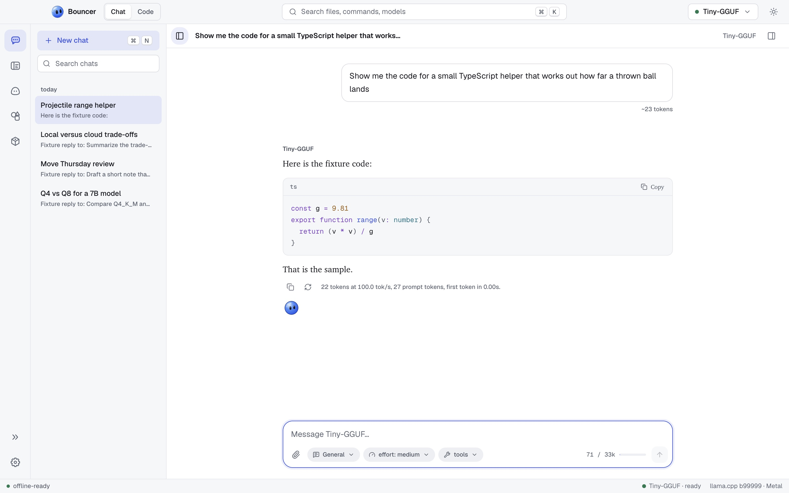
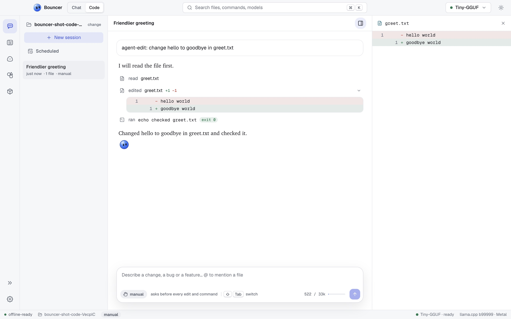
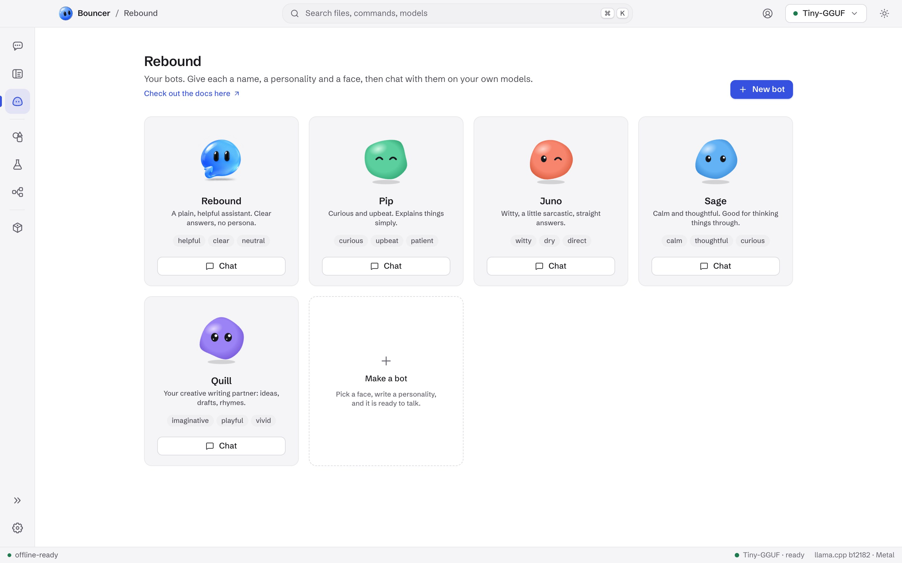

<p align="center">
  
</p>

<h1 align="center">Bouncer</h1>

<p align="center">
  <strong>Open models on your own computer, for chat, code and your own bots.</strong><br />
  Local-first. No account needed. No telemetry.
</p>

<p align="center">
  <a href="https://github.com/shankar-sachin/get-bouncer/releases/latest"></a>
  <a href="https://github.com/shankar-sachin/get-bouncer/releases"></a>
  
</p>

<p align="center">
  <a href="https://bouncer-ai.pages.dev"><strong>Website</strong></a> ·
  <a href="https://bouncer-ai.pages.dev/docs"><strong>Docs</strong></a> ·
  <a href="https://github.com/shankar-sachin/get-bouncer/releases/latest"><strong>Download</strong></a> ·
  <a href="CHANGELOG.md"><strong>Changelog</strong></a> ·
  <a href="https://github.com/shankar-sachin/get-bouncer/issues/new/choose"><strong>Report a bug</strong></a>
</p>

<p align="center">
  <picture><source media="(prefers-color-scheme: dark)" srcset="site/assets/screens/hero-obsidian.jpg"><source media="(prefers-color-scheme: light)" srcset="site/assets/screens/hero-light.jpg"></picture>
</p>

Bouncer is a local-first AI app for macOS, Windows and Linux. It finds open models on Hugging Face, checks they fit your machine, and runs them with [llama.cpp](https://github.com/ggml-org/llama.cpp) (GGUF) or [mlx-lm](https://github.com/ml-explore/mlx-lm) (MLX, on Apple silicon). Your chats, files and models stay on your computer.

## Install

**macOS and Linux**

```sh
curl -fsSL https://bouncer-ai.pages.dev/install.sh | sh
```

**Windows** (PowerShell 5.1 or 7)

```powershell
irm https://bouncer-ai.pages.dev/install.ps1 | iex
```

The installers fetch the [latest release](https://github.com/shankar-sachin/get-bouncer/releases/latest) and check it against its `SHA256SUMS`. Add `--dry-run` (`| sh -s -- --dry-run`) or `-DryRun` to see what would happen first, or pick a version with `--version v0.14.2` / `-Version v0.14.2`. Once installed, Bouncer updates itself.

Prefer to download it yourself? Every installer is on the [releases page](https://github.com/shankar-sachin/get-bouncer/releases):

| System | Download |
| --- | --- |
| macOS, Apple silicon | `Bouncer-<version>-arm64.dmg` |
| macOS, Intel | `Bouncer-<version>.dmg` |
| Windows 10 and 11 (x64) | `Bouncer-Setup-<version>.exe` |
| Linux | `.deb` for Debian and Ubuntu, or an AppImage, on releases that include them |

More in the [install guide](docs/install.md) and the [system requirements](docs/system-requirements.md).

## What's inside

| | |
| --- | --- |
| **[Chat](docs/chat.md)** | Talk with a model you've loaded: effort levels, presets, [slash commands](docs/slash-commands.md), attachments and Relics that open beside the chat. |
| **[Bouncer Code](docs/code.md)** | Describe a change in a folder. The model reads, edits and runs commands, and you review each change before it applies. Run it later with [scheduled tasks](docs/scheduled-tasks.md). |
| **[IDE](docs/ide.md)** | A file tree, editor tabs, a terminal, search and git in one window, with Bouncer Code docked beside it. |
| **[Rebound](docs/rebound.md)** | Your own bots, each with a name, a personality, a face and its own chats. Five starter bots to begin with. Also at [rebound.web.app](https://rebound.web.app). |
| **[Marketplace](docs/models.md)** | Find GGUF and MLX models on Hugging Face, with an estimate of how each one fits your machine. Install [packages](docs/bcr.md) that come with the settings a model runs best with. |
| **Studio** | Docs, decks, grids and designs you make with a model. Each one opens beside a chat. |
| **[Lab](docs/lab.md)** | Send one prompt to several models and compare the replies side by side, or rate them blind. |
| **[Workflows](docs/workflows.md)** | Chain models, tools and agents into steps. Run them by hand, on a schedule, from Rebound or from the terminal. |
| **[Skills](docs/skills.md)** | Reusable instructions that Chat, Rebound and Bouncer Code load when a task needs them. |
| **[Terminal](docs/cli.md)** | The `bouncer` command: pull, run and chat with models from your shell. |
| **[Cloud providers](docs/providers.md)** | Optional. Use Anthropic, OpenAI or OpenRouter models next to your local ones, with your own key. |
| **[Account](docs/account.md) and [Sync](docs/sync.md)** | Optional sign-in, and end-to-end encrypted sync of settings, presets and chosen chats across your computers. |

<p align="center">
  <picture><source media="(prefers-color-scheme: dark)" srcset="site/assets/screens/code-obsidian.jpg"></picture>
  <picture><source media="(prefers-color-scheme: dark)" srcset="site/assets/screens/rebound-obsidian.jpg"></picture>
</p>

## Documentation

The full guide is at **[bouncer-ai.pages.dev/docs](https://bouncer-ai.pages.dev/docs)**. Its source is in [`docs/`](docs/README.md), mirrored to the [wiki](https://github.com/shankar-sachin/get-bouncer/wiki).

- **Start:** [Getting started](docs/getting-started.md) · [Install](docs/install.md) · [Updates](docs/updates.md) · [System requirements](docs/system-requirements.md)
- **Reference:** [Keyboard shortcuts](docs/keyboard-shortcuts.md) · [Slash commands](docs/slash-commands.md) · [Settings](docs/settings.md) · [File formats](docs/file-formats.md)
- **Help:** [Troubleshooting](docs/troubleshooting.md) · [FAQ](docs/faq.md) · [Other providers (Ollama, LM Studio)](docs/other-providers.md)

## Unsigned builds

Builds aren't signed or notarized yet.

- **macOS:** the installer removes the quarantine flag. If you downloaded the `.dmg` yourself and macOS blocks it, right-click Bouncer and choose Open, or run `xattr -dr com.apple.quarantine /Applications/Bouncer.app`.
- **Windows:** SmartScreen may warn on first run. Choose More info, then Run anyway.

## Privacy

Bouncer is local-first. A chat with a local model is processed on your machine, and Bouncer has no analytics or telemetry. It goes online only for:

- **Hugging Face:** model listings, model cards and the files you choose to download. Your Hugging Face token is sent only to Hugging Face.
- **GitHub:** engine releases when you install or update llama.cpp, and the check for a new Bouncer version.
- **DuckDuckGo:** web search, only when you turn it on for a chat. It's off by default.
- **Cloud providers, sign-in and sync:** only if you turn them on.

The full list is in the [privacy policy](PRIVACY.md) and [docs/privacy.md](docs/privacy.md).

## Reporting bugs

[Open an issue](https://github.com/shankar-sachin/get-bouncer/issues/new/choose) and pick a template. Include your Bouncer version (**Settings › About**), your system, and the engine log lines around the error, with any private text removed. For security problems, see [SECURITY.md](SECURITY.md) and don't open a public issue.

## About this repository

Bouncer's source code is private. This repository holds everything public around it:

| Folder | What it holds |
| --- | --- |
| [`docs/`](docs/README.md) | The user guide, also on [the website](https://bouncer-ai.pages.dev/docs) and the [wiki](https://github.com/shankar-sachin/get-bouncer/wiki) |
| [`scripts/`](scripts) | The installers ([`install.sh`](scripts/install.sh), [`install.ps1`](scripts/install.ps1)) and the website build |
| [`site/`](site) | The website at [bouncer-ai.pages.dev](https://bouncer-ai.pages.dev) |
| [`examples/`](examples/README.md) | An example [`BOUNCER.md`](examples/BOUNCER.md) and [Rebound bot ideas](examples/rebound-bots.md) |
| [`plugins/`](plugins/README.md) | Official plugins and the plugin guide, once [plugins](docs/plugins.md) ship |
| [`.github/`](.github) | Issue templates and the wiki sync |

The old address, getbouncer.pages.dev, redirects to [bouncer-ai.pages.dev](https://bouncer-ai.pages.dev), so old links and install commands keep working.

## License

Bouncer is free to download and use, and its source code is private. See the [license](LICENSE.md) for the terms.

<sub>© Sachin Shankar. All rights reserved.</sub>
