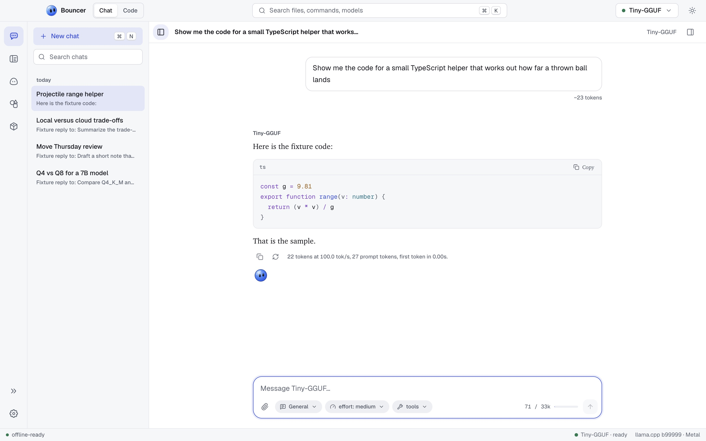

<p align="center">
  
</p>

# Bouncer

Bouncer is a local-first AI app for macOS, Windows and Linux. It runs open models on your own computer for chat, for coding in your folders, and for your own bots in Rebound. Models come from Hugging Face and run with llama.cpp.

<p align="center">
  <picture><source media="(prefers-color-scheme: dark)" srcset="site/assets/screens/hero-obsidian.jpg"><source media="(prefers-color-scheme: light)" srcset="site/assets/screens/hero-light.jpg"></picture>
</p>

This repository hosts the installers, the install scripts, the documentation and the website at https://bouncer-ai.pages.dev. Bouncer itself is closed source.

- [bouncer-ai.pages.dev](https://bouncer-ai.pages.dev): the website, the docs and the install scripts.
- [rebound.web.app](https://rebound.web.app): Rebound.
- [getbouncer.pages.dev](https://getbouncer.pages.dev): the old address. It redirects to bouncer-ai.pages.dev, so old links and install commands keep working.

## Get started

**macOS and Linux**

```sh
curl -fsSL https://bouncer-ai.pages.dev/install.sh | sh
```

**Windows** (PowerShell 5.1 or 7)

```powershell
irm https://bouncer-ai.pages.dev/install.ps1 | iex
```

The installers pick the newest release (all current releases are prereleases) and verify its `SHA256SUMS`. Add `--dry-run` (`| sh -s -- --dry-run`) or `-DryRun` to see what would happen first, or choose a version with `--version v0.3.0` / `-Version v0.3.0`.

To download an installer yourself, see the [releases page](https://github.com/shankar-sachin/get-bouncer/releases). Once installed, Bouncer updates itself.

## What is in the app

- **Bouncer Chat**: talk with a model you have loaded, with serif replies, the orb under each finished reply, effort levels, presets and slash commands.
- **Bouncer Code**: describe a change in a folder. The model reads, edits and runs commands, and each edit waits for your approval, depending on the mode you choose.
- **Bouncer IDE**: a file tree, editor tabs, a terminal, search and git in one window.
- **Rebound**: five starter bots, Rebound first, and your own bots, each with a name, a personality, a face and its own chats.
- **Marketplace**: find GGUF models from Hugging Face, with an estimate of whether each one fits your machine.
- **Bouncer Studio**: docs, decks, grids and designs. Coming later.

## Unsigned builds

Builds are not signed or notarized yet.

- **macOS:** the installer removes the quarantine flag. If you downloaded the `.dmg` yourself and macOS blocks it, right-click Bouncer and choose Open, or run `xattr -dr com.apple.quarantine /Applications/Bouncer.app`.
- **Windows:** SmartScreen may warn on first run. Choose More info, then Run anyway.
- **Linux:** a `.deb` for Debian and Ubuntu, or an AppImage for everything else.

## Documentation

- [Documentation site](https://bouncer-ai.pages.dev/docs)
- [Documentation source in docs/](docs/README.md)
- [Wiki](https://github.com/shankar-sachin/get-bouncer/wiki), synced from `docs/`

## Plugins

Plugins are coming. The [plugins/](plugins/README.md) folder will hold official plugins and the plugin authoring guide. See [docs/plugins.md](docs/plugins.md) for the current status.

## Reporting bugs

Open an issue at [github.com/shankar-sachin/get-bouncer/issues](https://github.com/shankar-sachin/get-bouncer/issues/new/choose) and pick a template. Include your Bouncer version (**Settings → About**), your system, and the engine log lines around the error. Remove any private text from logs first. For security problems, see [SECURITY.md](SECURITY.md) and do not open a public issue.

## Data and privacy

Bouncer is local-first. Your chats, models, and files stay on your computer, and a chat with a local model is processed by the model on your machine. Bouncer connects to the internet only for these tasks:

- **Hugging Face:** model listings, files and model cards for the Marketplace, and the model files you choose to download. Your Hugging Face token is sent only to Hugging Face.
- **GitHub:** llama.cpp releases when you install or update the engine, and a check for the latest Bouncer release.
- **DuckDuckGo:** web search, only when you turn it on for a chat. It is off by default.

Bouncer has no analytics or telemetry. See the [privacy policy](PRIVACY.md) and [docs/privacy.md](docs/privacy.md) for the full list.

## What's in this repository

Bouncer's source code is private. This repository holds everything public around it:

| Folder | What it holds |
| --- | --- |
| [`docs/`](docs) | The user guide, also shown on [bouncer-ai.pages.dev/docs](https://bouncer-ai.pages.dev/docs) and the wiki |
| [`scripts/`](scripts) | The installers (`install.sh`, `install.ps1`) and the website build |
| [`site/`](site) | The website at [bouncer-ai.pages.dev](https://bouncer-ai.pages.dev) |
| [`examples/`](examples) | An example `BOUNCER.md` and Rebound bot ideas |
| [`plugins/`](plugins) | Official plugins and the plugin guide, once plugins ship |
| [`.github/`](.github) | Issue templates and the wiki sync |

Installers for each version are attached to [Releases](https://github.com/shankar-sachin/get-bouncer/releases). Changes are in [CHANGELOG.md](CHANGELOG.md).

## License

Bouncer is free to download and use, and its source code is private. See the [license](LICENSE.md) for the terms.

---

© Sachin Shankar. All rights reserved.
