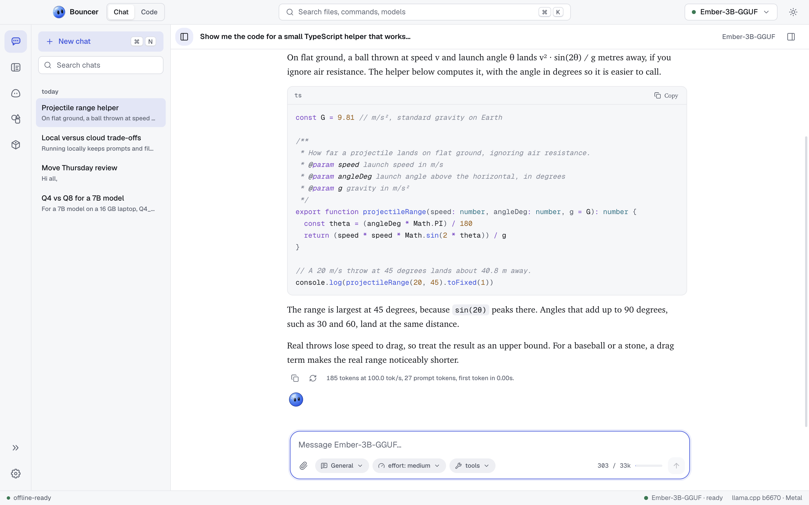

# Chat

Chat is where you talk with the model you have loaded, entirely on your computer. This page covers the conversation list, the composer, and the controls that shape each reply.

<picture><source media="(prefers-color-scheme: dark)" srcset="images/hero-obsidian.png"><source media="(prefers-color-scheme: light)" srcset="images/hero-light.png"></picture>

## Start a conversation

Click **New chat** at the top of the conversations sidebar, or press <kbd>⌘</kbd> <kbd>N</kbd> (<kbd>Ctrl</kbd> <kbd>N</kbd> on Windows and Linux). Type in the composer at the bottom and press <kbd>Enter</kbd> to send. Press <kbd>Shift</kbd> <kbd>Enter</kbd> for a new line.

Send stays disabled until a model is loaded. Load one from the model pill in the title bar.

Conversations are titled automatically after the first reply, and they are kept between launches.

## The conversations sidebar

The sidebar lists your chats, newest first.

- **Search**: type in the **Search chats** field. Results open the chat at the matching message.
- **Rename, pin, and delete**: hover a chat and use its controls. Delete asks you to confirm first.
- **Collapse**: click **Hide chats** in the sidebar header, or press <kbd>⌘</kbd> <kbd>\</kbd> (<kbd>Ctrl</kbd> <kbd>\</kbd> on Windows and Linux). Click **Show chats** or press the same keys to bring it back. The state is remembered after a relaunch.

## The composer

The composer has these controls under the text box:

- **Attach**: add **Files…**, **Images…**, or a **Folder…** to the message. Attachments appear as chips under the composer.
- **Preset**: choose the preset (system prompt and sampling) for this chat. See [presets and system prompts](#presets-and-system-prompts).
- **Effort**: how hard the model thinks before it answers. See [effort levels](#effort-levels).
- **Tools**: turn **Web search** and **Thinking** on or off for this chat.
- **Context meter**: the estimated prompt size and the loaded context size, for example `3.2k / 8k`. See [the context meter](#the-context-meter).

Attach a file or image by clicking **Attach**, or type a [slash command](slash-commands.md) such as `/effort high` to change the same settings from the keyboard.

Effort, tools, and preset are saved per conversation.

### Effort levels

Effort sets how much the model reasons and how long its reply may be. The levels are **low**, **medium** (the default), **high**, **xhigh**, and **max**:

| Level | Description |
| --- | --- |
| low | fast, minimal thinking |
| medium | balanced |
| high | thinks longer |
| xhigh | deep thinking, long answers |
| max | no limits, uses the whole context |

Models that cannot reason ignore the thinking part of this setting.

### Tools

- **Web search** lets the model search the web and read pages. It needs an internet connection.
- **Thinking** lets reasoning models think before they answer. Turn it off to get a direct answer from models that support it.

When the model uses a tool, the reply shows a short trace of the call.

### Presets and system prompts

A preset is a named system prompt with sampling settings. Bouncer includes five built-in presets: **General** (the default), **Budget**, **Sarcastic**, **Creative**, and **Explainer**.

- To switch presets for a chat, use the **Preset** chip or `/preset`.
- To change the text of a preset, open the chat settings panel, choose the preset, and edit its system prompt. Built-in presets can be edited, and **Reset to default** restores the original.
- To write a system prompt for only one conversation, use `/system <text>`.

## Chat settings

Click **Show chat settings** in the chat header to open the panel on the right. It shows:

- **model**: the loaded model, its quantization, size, trained and loaded context length, and the llama.cpp version and backend.
- **preset**: the preset for this chat, its system prompt, and whether it is built in.
- **sampling**: temperature, top-p, top-k, min-p, repeat penalty, and max tokens. A max tokens value of `0` means the reply runs until the model stops.

To set sampling for just the open chat, open the model panel from the model pill in the title bar and use its **Inference** tab.

## Replies

While a reply is streaming, the composer shows **Stop generating**. Press <kbd>Esc</kbd> to stop it too. The partial reply is kept and marked **stopped**.

Under each reply, use these actions:

- **Copy reply** copies the text.
- **Regenerate reply** writes a new answer. The old one stays as another branch.
- **Previous branch** and **Next branch** move between the replies you have generated.

To change one of your messages, hover over it and choose **Edit message**. Press <kbd>⌘</kbd> <kbd>↵</kbd> (<kbd>Ctrl</kbd> <kbd>Enter</kbd> on Windows and Linux) to save, or <kbd>Esc</kbd> to cancel. Saving creates a new branch with a fresh reply.

If a reply fails, the error appears with a **Retry** button.

### Reasoning blocks

Reasoning models show their thinking in a block above the reply. It reads **Thinking…** while the model works, then **Thought for** followed by the time. Open the block to read the reasoning. The composer shows a **reasoning** tag once the chat has any reasoning.

### Speed and token counts

Each reply shows its statistics under it: the tokens per second, the number of tokens, and the time to first token. A reply from an OpenRouter model also shows what it cost, for example `$0.0012`. The status bar also shows the latest tokens per second while you are in Chat.

A reply that stops at the length limit is marked **reached the token limit**.

## The context meter

The meter at the right end of the composer estimates how much of the model's context the next message will use. It counts the chat so far, the system prompt, your draft, and your attachments, against the loaded context size.

- Below 70 percent the meter is normal.
- At 70 percent or more it turns amber, and Bouncer suggests starting a new conversation. You can dismiss the suggestion.
- At 90 percent or more it turns red. Replies get worse from here and the next message may not fit, so start a new chat.

The count is an estimate, not the model's exact tokenizer count.

## Chat and Code

The title bar has a **Chat** and **Code** toggle. Chat is for conversations. Code is Bouncer Code, which works on a folder you open and can read and change its files.

## Related

- [Slash commands](slash-commands.md) for changing settings from the keyboard
- [Keyboard shortcuts](keyboard-shortcuts.md)
- [Models](models.md) for choosing and loading a model
- [Troubleshooting](troubleshooting.md) if a reply does not start
