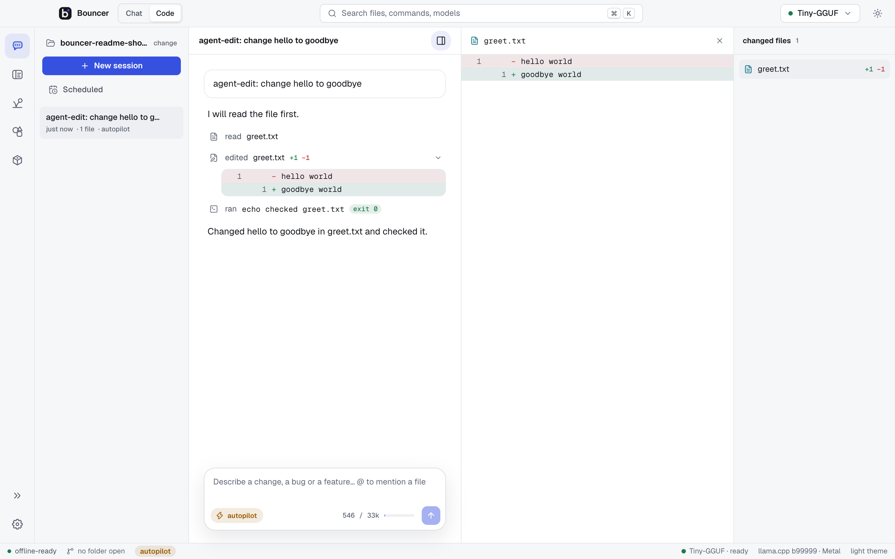

# Bouncer Code

Bouncer Code works inside a folder on your machine. You describe a change, and a model that runs locally reads the code, proposes edits, runs commands and summarizes what it did. You decide how much it may do on its own with the mode.

## Before you start

Bouncer Code needs a model loaded on this machine. If none is loaded, the composer says so and offers **Choose a model**. The start screen also lists a few coding models that fit your machine. See [Models](models.md) and [Recommended coding models](#recommended-coding-models).

## Choose a folder

Open the Code surface and click **Choose a folder**, or pick one from **recent folders**. Bouncer remembers the last six folders. Click the **x** next to a recent folder to remove it from the list.

Bouncer Code works inside the folder you choose, and only there. Its file tools cannot reach outside it.

To switch folders later, click the folder name at the top of the sessions list, then **change**.

## Sessions

A session is one conversation in a folder: your requests, the replies, the tool calls made, and the approvals you gave.

- **New session** starts an empty one. You can also type `/new`.
- The sessions list on the left shows the sessions in the current folder, newest first. A session that is still working shows a spinner.
- Click a session to open it. Hover a session and click the trash icon (**Delete session**) to remove it.
- Sessions are saved on your machine, so they are still there after you quit and reopen Bouncer.

The same sessions also appear in the Bouncer Code panel of the [IDE](ide.md), so you can start a change in either place.

## Modes

Every session runs in one of four modes. The mode decides which steps run without asking.

| Mode | What runs without asking | What asks first |
| --- | --- | --- |
| **plan** | Reading and searching files | Nothing changes. Edits and commands are refused, and Bouncer Code replies with a numbered plan instead. |
| **manual** | Reading, searching, and the todo list | Every edit and every command |
| **accept edits** (default) | Reading, searching, file edits and the todo list | Commands |
| **autopilot** | Everything in the folder | Risky commands (see below) |

Switch the mode with **Shift**+**Tab** (the mode chip in the composer also changes it when you click it). The order is plan, manual, accept edits, autopilot, then back to plan. Shift+Tab works while focus is in the composer or on nothing in particular. It does not work while the cursor is in the editor or the terminal, because those use Tab themselves.

The mode applies to the next step. You can change it in the middle of a session.

### What Bouncer Code can do

| Kind | Tools | Notes |
| --- | --- | --- |
| Read | `list_dir`, `glob`, `grep`, `read_file` | Look at folders, find files and text, read files. Always allowed. |
| Edit | `edit_file`, `write_file` | Change a part of a file, or write a whole file. |
| Run | `run_command` | Run a shell command in the folder, such as a test, a build or a linter. |
| Plan | `todo_write` | Keep a todo list for multi-step work. Always allowed. |

### What always asks

Some commands ask in every mode except plan (where nothing runs). These are commands that install packages, publish code, or delete or rewrite a lot at once. Examples:

- Package installs: `npm install`, `pip install`, `brew install`, `cargo install`, and similar
- Pushes and history rewrites: `git push`, `git reset --hard`, `git rebase`, `git clean -f`
- Bulk deletes and permission changes: `rm -r`, `chmod -R`, `chown`
- Piping a download straight into a shell

Autopilot still shows these commands and waits for you.

### What is never allowed

Some commands never run, in any mode. Bouncer refuses them and tells Bouncer Code why. These include `sudo`, commands that format disks or wipe partitions, `shutdown` and `reboot`, and `rm -rf` on your home folder or the root of the disk.

## Approve or deny a step

When a step needs your say-so, a card appears in the transcript:

- An edit shows its diff under **Make this edit?** with **Apply**.
- A command shows the command under **Run this command?** with **Run**.

To answer:

- **Apply** or **Run** approves the step. Press <kbd>⌘</kbd> <kbd>↵</kbd> (<kbd>Ctrl</kbd> <kbd>Enter</kbd> on Windows and Linux).
- **Deny** refuses it. Press <kbd>Esc</kbd>. Bouncer Code is told you refused and carries on.
- To refuse and say what you want instead, type in the box next to **Deny** (**or tell it what to do instead**) and press Enter. Bouncer Code treats your words as the reason for the refusal.

These keys work while the cursor is in the Code surface. In the IDE, they work only while the cursor is in the Bouncer Code panel, so <kbd>Esc</kbd> still closes things in the editor.

## Diffs, changed files and the review panel

Every edit is shown as a diff: removed lines in red, added lines in green.

The **changed files** rail on the right lists each file the session changed, with its added and removed line counts. A file the session created is marked **new**. Click a file to open its full diff in the review panel. Click it again, or the **x**, to close the panel. Use the button in the header of the session to show or hide the rail.

## Rewind

Hover a prompt in the transcript and click **rewind**. You get three choices:

| Choice | What happens |
| --- | --- |
| **Restore files and conversation** | Files go back to how they were before that prompt, and the conversation is cut back to that point. The prompt returns to the composer so you can edit and send it again. |
| **Restore files only** | Files go back to how they were before that prompt. The conversation stays as it is. |
| **Rewind conversation only** | The conversation is cut back. Files stay as they are now. |

Bouncer takes a snapshot of your project before each turn, so rewinding works in folders that are not git repositories too. The snapshot is kept outside your project. It does not touch your git history, index or stash.

Restoring files puts every project file back to its state at that prompt. That includes any edits you made by hand after it. Check the changed files rail first if you have unsaved work in the folder.

## @ mentions

Type `@` in the composer to pick a file from the folder. The list filters as you type, so `@gre` finds `greet.txt`. Press Enter to insert it. Mention up to eight files per prompt. Their contents are attached to your message, so the model can use them without reading them first.

## Project instructions: BOUNCER.md

A file called `BOUNCER.md` in the root of a folder holds instructions for Bouncer Code in that folder, such as the build command, the test command and your coding conventions. Bouncer Code reads it at the start of every turn and follows it. The first 20,000 characters are used.

To create one, type `/init` in the composer. Bouncer Code looks at the folder and writes `BOUNCER.md`. Because that is an edit, it asks for approval in manual mode. In plan mode it can't write the file, so switch to another mode first.

## Context meter, warnings and compaction

The model has a fixed context size, and a session uses up part of it with every turn. The meter in the composer shows how much of the context the last turn used, for example `546 / 33k`. Its bar turns yellow at 70% and red at 90%.

- **At 70%** a notice says the session is getting long, with **New session** and a dismiss button. Starting a new session keeps replies fast and sharp.
- **At 90%** the notice stays. Replies get worse from here, and the next turn may not fit.
- **Compact** summarizes the older part of the session into a short set of notes, and keeps the session. The summary covers your goal, what has changed and why, the current state, and what is left. Type `/compact` to do the same thing. A session at 85% of the context is also compacted automatically before the next turn.

If the context is still full after compacting, start a new session.

## Recommended coding models

The start screen and an empty session show up to three models that suit coding and fit your machine. Each opens in the Marketplace, where you can see the exact files.

These are the models Bouncer currently recommends. Sizes are approximate for the quantization shown:

| Model | Quantization | Approximate size | Note |
| --- | --- | --- | --- |
| Qwen 3 4B Instruct | Q4_K_M | 2.5 GB | Small and quick, fine for simple edits on 8 GB machines |
| Qwen 3 8B | Q4_K_M | 5 GB | Reliable tool calls in a small package |
| Qwen 3 14B | Q4_K_M | 9 GB | A step up in planning for 16 GB machines |
| gpt-oss 20B | MXFP4 | 12.1 GB | Strong reasoning, fast as a mixture-of-experts model |
| Devstral Small | Q4_K_M | 14.3 GB | Built by Mistral for coding |
| Qwen 3 Coder 30B A3B | Q4_K_M | 18.6 GB | A strong local model for coding on 32 GB machines |
| gpt-oss 120B | MXFP4 | 63 GB | Near frontier quality, for 96 GB+ workstations |
| GLM 4.5 Air | Q4_K_M | 70 GB | Strong at multi-step coding, for 96 GB+ workstations |

### What "fits" means

Bouncer estimates how much memory a model needs as its file size plus 20%, to leave room for the context. It compares that with the memory the model can use:

- **With a discrete GPU**, the GPU's memory.
- **On Apple silicon**, 70% of the unified memory.
- **Otherwise**, 60% of RAM.

A model is **fits this machine** when the need is at most 85% of that memory, **tight fit** when it is at most 100%, and **too big here** when it is more. A tight fit runs, but leaves less room for a long context. Models that are too big are left out of the list.

## Related

- [Chat](chat.md): the same models, for conversation without a folder
- [Scheduled tasks](scheduled-tasks.md): run a prompt in a folder later or on a schedule
- [Bouncer IDE](ide.md): the editor, with Bouncer Code docked beside it
- [Models](models.md): choose, download and load models
- [Keyboard shortcuts](keyboard-shortcuts.md): every shortcut in one place
