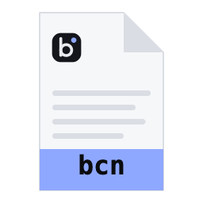
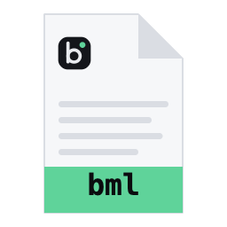
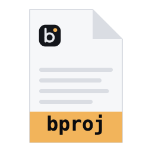

# File formats

Bouncer saves three kinds of file so you can share and reuse your setup: a configuration file (`.bcn`), a model file (`.bml`), and a project file (`.bproj`). Each one is plain JSON, so you can read it, diff it, and keep it in version control.

## The three file types

| File | Icon | Name | What it holds |
| --- | --- | --- | --- |
| `.bcn` |  | Bouncer Configuration | Settings, chat presets, and the mode. |
| `.bml` |  | Bouncer Model | A model manifest: where to get the model, and its load and sampling settings. |
| `.bproj` |  | Bouncer Project | A coding project: its name, folder, instructions file, and mode. |

None of these files ever contains your Hugging Face token. Bouncer ignores unknown fields when it reads or writes a file, so a token cannot be stored in one by accident.

## Open a file

Double-click a `.bcn`, `.bml`, or `.bproj` file, or use **Open with** on your system to choose Bouncer. You can also pick the file from Bouncer's open dialog. Bouncer reads the file and then does one of three things.

| File | What happens |
| --- | --- |
| `.bproj` | The project folder opens in the IDE right away. If you last used Bouncer Code, it opens there instead. |
| `.bml` | An **Open model** dialog shows the model, its repo and file, and its load settings. It also says whether the model is already in your library. Click **Load** if it is, or **Open in Marketplace** to find and download it. |
| `.bcn` | An **Import settings** dialog lists what the file holds: settings, presets, and mode. Tick the parts you want, then click **Import**. |

If Bouncer cannot read a file, the **Couldn't open this file** dialog says why. For example, a damaged file reports where the JSON is broken, with its line and column.

## Export a file

- **Configuration (.bcn)**: open **Settings > Experience** and click **Export settings…**. You can also run **Export settings** from the command palette.
- **Model (.bml)**: in **Models > Library**, use the **Export** action on a model you downloaded from Hugging Face. Models you imported from a local file have no repo, so they cannot be exported.
- **Project (.bproj)**: run **Export project file** from the command palette while a project is open. The file is saved in the project folder by default.

## Bouncer Configuration (.bcn)

A `.bcn` file carries the settings you choose to share between machines. It leaves out machine-specific values, such as the onboarding state and your list of recent folders.

Fields:

| Field | Type | Notes |
| --- | --- | --- |
| `format` | `"bouncer.config"` | Required. Identifies the file. |
| `version` | integer | Required. The format version, currently `1`. |
| `settings` | object | Optional. Any of the settings below. Each one may be left out. |
| `settings.theme` | `system`, `dark`, `light`, `obsidian` | The app theme. `dark` is the Graphite theme. |
| `settings.accent` | `auto`, `signal`, `slate`, `mono`, `ember`, `glacier`, `ultraviolet`, `lime` | The accent color. |
| `settings.highContrast` | boolean | Stronger text and borders. |
| `settings.surface` | `chat`, `code`, `ide`, `rebound`, `studio`, `models` | The screen Bouncer opens to. |
| `settings.uiMode` | `standard`, `developer` | Standard or developer mode. |
| `settings.guardrails` | `off`, `relaxed`, `strict` | How Bouncer treats models that won't fit. |
| `settings.enabledGpus` | array of GPU indexes, or `null` | Which GPUs the engine may use. `null` means all. |
| `settings.editorFontSize` | integer, 9 to 32 | Editor font size. |
| `settings.editorTabSize` | integer, 1 to 8 | Editor tab width. |
| `settings.editorWordWrap` | boolean | Wrap long lines in the editor. |
| `settings.editorMinimap` | boolean | Show the editor minimap. |
| `presets` | array, up to 200 | Chat presets. Each has a `name` (1 to 80 characters), a `systemPrompt` (up to 20,000 characters), and optional `sampling`. Built-in presets are not exported. |
| `agent` | object | Optional. `agent.mode` is one of `plan`, `manual`, `accept-edits`, `autopilot`. |
| `exportedAt` | ISO 8601 date and time | When the file was written. |
| `app.version` | string | The Bouncer version that wrote the file. |

A `sampling` object may contain any of these optional fields: `temperature` (0 to 5), `topP` (0 to 1), `topK` (integer, 0 to 1000), `minP` (0 to 1), `repeatPenalty` (0.5 to 3), and `maxTokens` (integer, 0 to 1,048,576).

Example:

```json
{
  "format": "bouncer.config",
  "version": 1,
  "settings": {
    "theme": "dark",
    "accent": "signal",
    "editorFontSize": 13,
    "editorTabSize": 2
  },
  "presets": [
    {
      "name": "Careful writer",
      "systemPrompt": "You are a careful editor. Keep the author's voice and flag anything unclear.",
      "sampling": { "temperature": 0.4, "topP": 0.9 }
    }
  ],
  "agent": { "mode": "plan" },
  "exportedAt": "2026-10-16T09:00:00.000Z",
  "app": { "version": "0.0.0" }
}
```

## Bouncer Model (.bml)

A `.bml` file is a manifest. It tells Bouncer which Hugging Face file to download and how to load it. It does not contain the model weights.

Fields:

| Field | Type | Notes |
| --- | --- | --- |
| `format` | `"bouncer.model"` | Required. |
| `version` | integer | Required. Currently `1`. |
| `repo` | string | Required. A Hugging Face repo in the form `owner/name`. |
| `file` | string | Required. The `.gguf` file name, with no folders. |
| `quant` | string, up to 40 characters | Optional. The quantization, such as `Q4_K_M`. |
| `sha256` | 64 hex characters | Optional. The expected SHA-256 hash of the file. |
| `sizeBytes` | integer | Optional. The expected file size in bytes. |
| `label` | string, up to 120 characters | Optional. The name shown in Bouncer. |
| `load` | object | Optional. Load settings, described below. |
| `sampling` | object | Optional. Sampling settings, the same as in `.bcn` presets. |

Load settings, each optional:

| Field | Values |
| --- | --- |
| `ctxSize` | integer from 512 to 1,048,576, or `null` for the model's default |
| `gpuLayers` | `auto`, `all` (the max setting), or an integer from 0 to 1000 |
| `flashAttn` | `auto`, `on`, `off` |
| `cacheTypeK`, `cacheTypeV` | `f16`, `q8_0`, `q4_0` |
| `threads` | integer from 1 to 512, or `null` |
| `batchSize` | integer from 16 to 16,384, or `null` |
| `mmap` | boolean |
| `kvOffload` | boolean |

Example:

```json
{
  "format": "bouncer.model",
  "version": 1,
  "repo": "unsloth/Qwen3-8B-GGUF",
  "file": "Qwen3-8B-Q4_K_M.gguf",
  "quant": "Q4_K_M",
  "label": "Qwen3 8B (Q4_K_M)",
  "load": {
    "ctxSize": 8192,
    "gpuLayers": "all",
    "flashAttn": "auto"
  },
  "sampling": {
    "temperature": 0.6,
    "topP": 0.95,
    "topK": 20,
    "minP": 0
  }
}
```

Opening this file in Bouncer shows the model and its settings. If the model is not in your library, click **Open in Marketplace** to download it. The `sha256` and `sizeBytes` fields are optional. They describe the file you expect, so you can share a manifest without the weights.

## Bouncer Project (.bproj)

A `.bproj` file points Bouncer at a project folder and sets how Bouncer Code works in it.

Fields:

| Field | Type | Notes |
| --- | --- | --- |
| `format` | `"bouncer.project"` | Required. |
| `version` | integer | Required. Currently `1`. |
| `name` | string, 1 to 200 characters | Required. The project name. |
| `root` | string | Required. The project folder. An absolute path, or a path relative to the folder that holds the `.bproj` file. `"."` means the same folder. |
| `instructions` | string | Optional. The instructions file for Bouncer Code, default `BOUNCER.md`. |
| `agent` | object | Optional. `agent.mode`, as in `.bcn`. |

Example:

```json
{
  "format": "bouncer.project",
  "version": 1,
  "name": "Example project",
  "root": ".",
  "instructions": "BOUNCER.md",
  "agent": { "mode": "accept-edits" }
}
```

Keep the `.bproj` file in the project folder and use a relative `root` (such as `"."`), so the project still opens if you move or share the folder.

## Modes

The `agent.mode` field takes one of four values. They appear in Bouncer as:

| Value | Label | What it does |
| --- | --- | --- |
| `plan` | plan | Reads files and replies with a plan. Makes no changes. |
| `manual` | manual | Asks before every edit and command. |
| `accept-edits` | accept edits | Applies edits, and asks before running commands. |
| `autopilot` | autopilot | Runs everything in the project folder without asking. |

## Versions

Every file carries a `version` number. The current version of all three formats is `1`.

- If a file's version is newer than your copy of Bouncer, Bouncer refuses to open it and says **Made by a newer Bouncer (version N); update to open it**. Update Bouncer, then open the file again.
- The version number lets a future Bouncer change the format and still read files written today.
- Bouncer rejects files larger than 5 MB.

## Related

- [Settings](settings.md): the settings a `.bcn` file can carry.
- [Models](models.md): downloading models and managing your library.
- [Code](code.md): working with projects and Bouncer Code.
- [Privacy](privacy.md): what stays on your machine.
