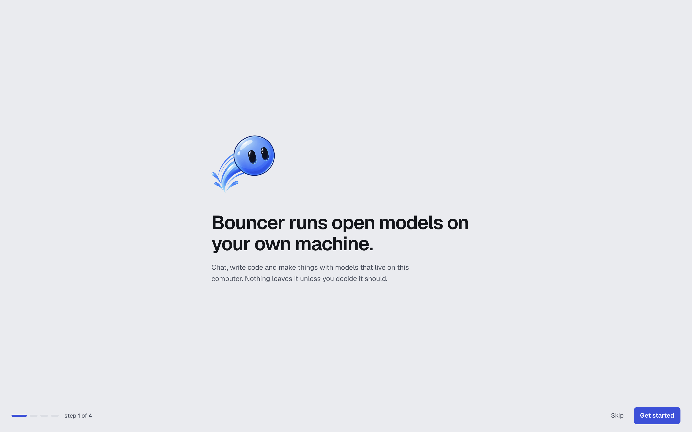

# Getting started

This guide takes you from a fresh install to your first chat with a model running on your own computer. It takes about ten minutes, plus the time it takes to download a model.

<picture><source media="(prefers-color-scheme: dark)" srcset="images/hero-obsidian.png"><source media="(prefers-color-scheme: light)" srcset="images/hero-light.png"></picture>

## 1. Install Bouncer

Run the installer for your system, or download the installer yourself. See [Install](install.md) for the one-line commands and the manual downloads for macOS, Windows and Linux.

Builds are not signed yet. The first launch may show a warning from macOS or Windows. [Install](install.md#unsigned-builds) explains how to get past it.

## 2. First launch

When Bouncer opens for the first time, a short onboarding dialog walks you through four steps:

1. **Welcome.** A summary of what Bouncer does: chat and code with models that run on this computer.
2. **Customize your experience.** Pick a theme from three cards: **Graphite** (soft dark gray), **Light** (paper) or **Obsidian** (pitch black). Each card previews its theme, and the choice applies at once. You can change it later in Settings.
3. **Three ways to work.** An overview of **Bouncer Chat**, **Bouncer Code** and **Bouncer Studio**, which is coming later.
4. **Bring a model.** A note that Bouncer checks what fits your machine before anything downloads. Use **Browse models** to go to the Marketplace now, or **Later** to finish.

<picture><source media="(prefers-color-scheme: dark)" srcset="images/onboarding-obsidian.png"><source media="(prefers-color-scheme: light)" srcset="images/onboarding-light.png"></picture>

Press **Skip** at any time to close onboarding. You can open it again from Settings with **Replay onboarding**.

If you finished setting up Bouncer before the theme step existed, the same choice appears once, in a dialog, the next time you open it. Picking a theme or closing the dialog keeps it from coming back.

## 3. Install the engine

Bouncer runs models with llama.cpp. The engine is a separate download, and models cannot run until it is installed.

1. Open the **Marketplace** from the left bar, or press <kbd>⌘</kbd> <kbd>6</kbd> (macOS) or <kbd>Ctrl</kbd> <kbd>6</kbd> (Windows and Linux).
2. In the **this machine** panel on the left, the **engine** card says *llama.cpp is not installed. Models need it to run.*
3. Click **Install llama.cpp · Metal** (the button names the backend Bouncer recommends for your hardware, such as CUDA or CPU). The card shows the download progress. Use **Cancel** to stop it.

The backend is the part of llama.cpp that uses your hardware, such as Metal on Apple Silicon or CUDA on an NVIDIA GPU. [System requirements](system-requirements.md) lists the options for each platform.

## 4. Pick and download a first model

Start with a small model. A model in the 4 to 8 billion parameter range is a good first pick on most laptops.

1. In the **Marketplace**, use the **Discover** tab to search, or turn on the **fits this machine** filter to hide models that are too large for your computer.
2. Open a model. Its page lists the available quantized files, which are smaller versions of the model.
3. Each file has a fit label:
   - **Runs well**: comfortable headroom for your other apps.
   - **Tight fit**: it loads, but other apps may push the system into swap, which makes it slow.
   - **Too large**: it will not load alongside the operating system on this machine.
4. Choose a file marked **Runs well** or **Tight fit** and click **Download**, which shows the file size on the button.
5. Follow the progress on the **Downloads** tab. You can keep using Bouncer while it downloads.

When the download finishes, the model is in the **Library** tab. Click **Load** to start it. Downloads need an internet connection. Once a model is on your computer, you can use it offline.

Some models are gated on Hugging Face. To download them, add a Hugging Face access token in **Settings → Hugging Face** and accept the model's license on huggingface.co.

## 5. Start your first chat

1. Press <kbd>⌘</kbd> <kbd>1</kbd> (macOS) or <kbd>Ctrl</kbd> <kbd>1</kbd> (Windows and Linux) to open **Bouncer Chat**.
2. Check the model pill in the title bar. It shows the loaded model and its state. The composer says *Load a model to start chatting* until a model is ready.
3. Pick a starter prompt, such as **Explain something simply**, or type your own message. Starters only fill the composer. Nothing is sent until you press <kbd>Enter</kbd>.
4. Watch the speed in the status bar, which shows tokens per second while a reply streams.

Everything in the chat stays on this computer.

## Where to go next

- [Chat](chat.md): threads, attachments and chat settings.
- [Models](models.md): the Marketplace, the Library and how fit is estimated.
- [Bouncer Code](code.md) and [Bouncer IDE](ide.md): work on a folder of code with a model that runs on this computer.
- [Rebound](rebound.md): make your own bots, each with its own room of chats.
- [Settings](settings.md): themes, the engine, Hugging Face and hardware guardrails.
- [Keyboard shortcuts](keyboard-shortcuts.md): move around faster.
- [Troubleshooting](troubleshooting.md): if a model does not load or a download fails.

## Related

- [Install](install.md)
- [System requirements](system-requirements.md)
- [Models](models.md)
- [Troubleshooting](troubleshooting.md)
