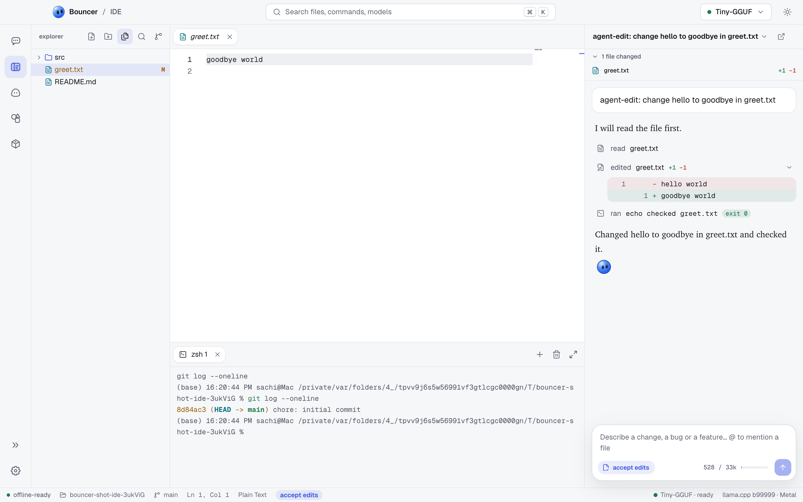

# Bouncer IDE

Bouncer IDE is an editor for a folder, with Bouncer Code docked on the right. Open a folder, edit its files, search, run commands in a terminal, and commit with source control. The Bouncer Code panel uses the same sessions as [Bouncer Code](code.md) for that folder.

<picture><source media="(prefers-color-scheme: dark)" srcset="images/ide-obsidian.png"><source media="(prefers-color-scheme: light)" srcset="images/ide-light.png"></picture>

## Open a folder

Open the IDE from the activity bar. It opens the folder you were working on in [Bouncer Code](code.md), so the editor and the Code view show the same folder and the same session.

If you have not worked in a folder yet, the IDE shows a welcome screen:

- Click **Open folder…** to choose a folder.
- Or pick one from **recent folders**.

The welcome screen also lists the keyboard shortcuts. A folder you open here is also the folder Bouncer Code works in.

## Layout

From left to right:

- **Sidebar**: the **Explorer**, **Search** and **Source control** views. Use the icons at the top of the sidebar to switch between them.
- **Editor**: the open files, in tabs. The terminal panel sits under the editor.
- **Bouncer Code panel**: Bouncer Code for the folder. It is always shown while a folder is open.

Drag the dividers between the panels to resize them.

## Explorer

The Explorer lists the files and folders in the folder. Click a folder to open or close it.

- Click a file once to open it as a **preview tab**. Its name is in italics. Opening another file with a single click replaces the preview tab.
- Double-click a file, or start editing it, to keep it open as a normal tab.
- Use the **New file** and **New folder** buttons at the top of the Explorer, or right-click an item for **Rename**, **Delete**, **Copy path** and **Copy relative path**.

## Tabs and split groups

- A tab shows a dot or the word **unsaved** when it has changes that are not saved.
- Close a tab with the **x** on it, middle-click it, or press <kbd>⌘</kbd> <kbd>W</kbd> (<kbd>Ctrl</kbd> <kbd>W</kbd> on Windows and Linux).
- Closing a tab with unsaved changes asks **Save changes to <file>?** with **Save** or **Discard**. Press <kbd>Esc</kbd> to keep the tab open.
- Split the editor with <kbd>⌘</kbd> <kbd>\</kbd> (<kbd>Ctrl</kbd> <kbd>\</kbd>). A second editor group opens beside the first, so you can read two files side by side.

Save the active file with <kbd>⌘</kbd> <kbd>S</kbd> (<kbd>Ctrl</kbd> <kbd>S</kbd>).

## Quick open and command palette

- <kbd>⌘</kbd> <kbd>P</kbd> (<kbd>Ctrl</kbd> <kbd>P</kbd>) opens **Go to file**. Type part of a name, not necessarily from the start: `sapp` finds `src/app.ts`. Press Enter to open the highlighted file.
- <kbd>⌘</kbd> <kbd>K</kbd> (<kbd>Ctrl</kbd> <kbd>K</kbd>) opens the command palette, for everything else in Bouncer.

## Search

Open the **Search** view and type text. Results are grouped by file, and each match shows the line it is on. Click a match to open the file at that line.

## Terminal

Press <kbd>⌘</kbd> <kbd>J</kbd> (<kbd>Ctrl</kbd> <kbd>J</kbd>) to show or hide the terminal panel. Each terminal runs in the folder.

- The **+** button starts a new terminal. The trash button kills all terminals.
- Use the **maximize panel** button to make the panel fill the editor.
- When a shell exits, the terminal shows `[process exited with code 0]` (or another code) and a **restart** button.

While the cursor is in the terminal, Tab goes to the shell, not to Bouncer.

## Source control

Open the **Source control** view to see what has changed in the folder since the last commit.

- Changes are listed as staged and unstaged. Hover a file and click **stage** to stage it, or **unstage** to take it out again. **stage all** and **unstage all** work on the whole list.
- Click a file to open its diff in a tab.
- Type a message in the **commit message** box. Press <kbd>⌘</kbd> <kbd>↵</kbd> (<kbd>Ctrl</kbd> <kbd>Enter</kbd>) or click **Commit** to commit the staged changes.
- With nothing staged but tracked files changed, the button reads **Commit all**. It stages those files first.
- Tick **Amend** to replace the last commit, with a new message if you like.
- The last commit's message is shown under the box.

If the folder is not a git repository, the view says so. Run `git init` in the terminal to start tracking changes.

Bouncer does not push. To publish commits, use your terminal or your git host.

## Files on disk and unsaved edits

Bouncer watches the folder. Changes made outside the IDE, by another program, by a terminal command or by Bouncer Code, appear in the Explorer and in source control as they happen.

- A file that is open and has no unsaved edits reloads when it changes on disk.
- If you have unsaved edits and the file changes on disk, a bar appears above the editor: **This file changed on disk, and you have unsaved edits.** Choose **Reload** to take the file on disk and lose your edits, or **Overwrite** to keep your edits and replace the file on disk.
- A file deleted on disk closes its tab if it has no unsaved edits. If it has edits, the tab stays open and is flagged.

Files that are binary, or too large to open here, show a message instead of an editor.

## Editor settings

The editor follows the app's theme and accent color. Its defaults are a 13 px font, a tab width of 2, word wrap off and the minimap on. The Settings screen does not offer these yet.

## The Bouncer Code panel

The panel on the right is Bouncer Code for the open folder. It works the same way as [Bouncer Code](code.md).

<picture><source media="(prefers-color-scheme: dark)" srcset="images/ide-session-obsidian.png"><source media="(prefers-color-scheme: light)" srcset="images/ide-session-light.png"></picture>

- **The session title** at the top is a menu. Use it to start a **New session** or switch to another session in this folder. A session that is working says so.
- **Open in Bouncer Code** (the arrow icon) opens the same session in the Code view.
- **N files changed** lists the files the session changed. Click a file to open it in the editor, showing the new content.
- The **composer** works as it does in Bouncer Code: type a request, use @ to mention a file, and Shift+Tab to change the mode. The mode also shows in the status bar.

Approvals work the same way as in Bouncer Code (<kbd>⌘</kbd> <kbd>↵</kbd> to approve, <kbd>Esc</kbd> to deny). They apply only while the cursor is in the Bouncer Code panel. Pressing <kbd>Esc</kbd> in the editor does not deny an edit that is waiting for you, because the editor keeps that key.

## Related

- [Bouncer Code](code.md): sessions, modes, approvals and rewind
- [Scheduled tasks](scheduled-tasks.md): run prompts in a folder later, and review their changes
- [Keyboard shortcuts](keyboard-shortcuts.md): every shortcut in one place
- [Troubleshooting](troubleshooting.md): when something in the IDE does not behave as described
