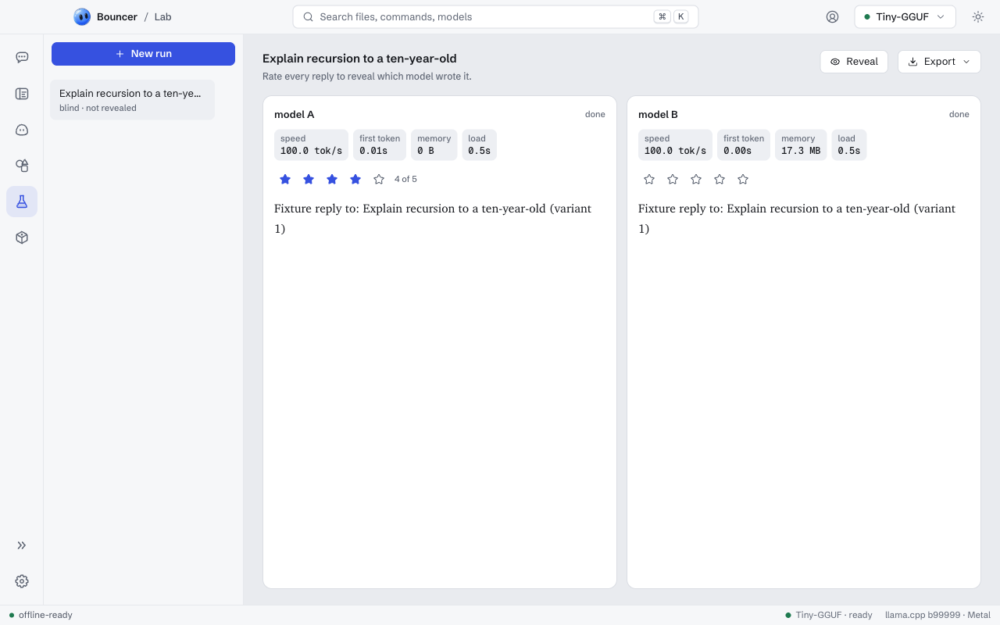

# Lab

Lab sends one prompt to two to six models and shows the replies side by side, with each model's speed and memory. Rate the replies blind, then see which model wrote which. Open it from the Lab icon in the rail, or with <kbd>⌘</kbd> <kbd>6</kbd> (<kbd>Ctrl</kbd> <kbd>6</kbd> on Windows and Linux).

<picture><source media="(prefers-color-scheme: dark)" srcset="images/lab-obsidian.png"><source media="(prefers-color-scheme: light)" srcset="images/lab-light.png"></picture>

## Start a run

1. Click **New run**.
2. Type the **prompt**, and a **system prompt** if you want one.
3. Pick two to six **models**: the local models in your library, and cloud models with **add a cloud model** if you turned a [cloud provider](providers.md) on.
4. Leave **Blind** on to hide the model names until you have rated the replies.
5. Click **Run**.

Local models run one after another: each loads, answers and unloads, so its numbers are measured with the computer to itself, and models of any size fit one at a time. Models you had loaded before the run are loaded again at the end. Cloud models just get the request. **Stop** ends the reply in progress and skips the rest.

## The numbers

Each reply shows:

- **speed**: tokens per second while it answered.
- **first token**: how long until the first token arrived.
- **memory**: how much more of your computer's memory was in use while the model was loaded. Other apps change this too, so read it as an estimate. Cloud models show none.
- **load**: how long loading the model took. Cloud models show none.

## Rate and reveal

Rate each finished reply from one to five stars. Click the same star again to clear it. In a blind run the models show as **model A**, **model B** and so on; once every finished reply has a rating, the names appear and the best-rated reply gets a **best** badge. **Reveal** shows the names without rating.

## History and export

Every run is saved on your computer, newest first, in the list on the left. A row shows the run's models, or the best one once rated; a blind run that has not been revealed stays hidden. Hover a row to delete it.

**Export** saves the open run:

- **Markdown**: the prompt, a table of the numbers and ratings, then each reply.
- **CSV**: one row per model with its rating, numbers and reply, for a spreadsheet.

A blind run that has not been revealed exports as model A, model B and so on, without providers.

## Related

- [Models](models.md): download and load models.
- [Cloud providers](providers.md): add Anthropic, OpenAI or OpenRouter models.
- [Skills](skills.md): reusable instructions for Chat, Rebound and Bouncer Code.
