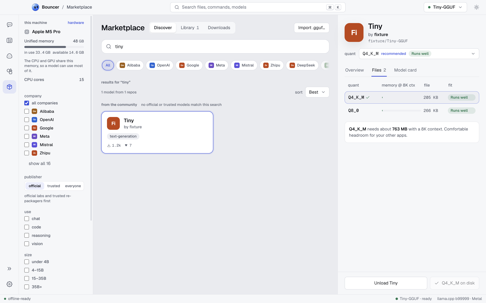

# Models

Bouncer runs open models in the GGUF format. The Marketplace finds them on Hugging Face, downloads them into your library, and loads them for chat and coding. This page covers each part of that flow.

<picture><source media="(prefers-color-scheme: dark)" srcset="images/model-detail-obsidian.png"><source media="(prefers-color-scheme: light)" srcset="images/model-detail-light.png"></picture>

## Find a model

Open **Models** and stay on the **Discover** tab. Type in the search box, which reads **Search GGUF models on Hugging Face**, or browse the list.

Use the filters to narrow the list:

| Filter | Options | What it does |
| --- | --- | --- |
| Sort | Most downloaded, Most liked, Trending | Orders the results. |
| Publisher | official, trusted, everyone | Limits results to publishers you trust (see below). |
| Use | chat, code, reasoning, vision | Shows models built for that job. |
| Size | under 4B, 4–15B, 15–35B, 35B+ | Filters by parameter count. |
| Fits this machine | switch | Shows only models that run on your hardware. It needs file sizes, so it is off until hardware info loads. |

### Publisher badges

Some publishers carry a badge on their model cards:

- **verified publisher** (a filled seal): the model comes from the company or lab that made it.
- **trusted re-packager** (an outline seal): a well-known packager that converts an official model into GGUF files. The card names the original model.

Choose **official** to see only verified publishers, or **trusted** to include re-packagers. **everyone** shows all results.

### Families and sizes

Models with several quantizations appear once, grouped under their family. Open a model to see every size and quant it offers.

## Pick a quantization

A quantization (quant) is a compressed version of a model. Smaller quants use less memory and download faster, and they lose a little quality. Larger quants are closer to the original.

On a model page, the **Quantization** list shows each file with its size and fit for your machine. Bouncer marks a recommended quant. Pick the largest quant that still shows **Runs well** if you want the best quality without slowdowns.

## Check the fit

Each quant gets a fit label based on an estimate of the memory it needs. The estimate covers the model file, the memory for the context window, and some overhead for the app.

| Label | Meaning |
| --- | --- |
| Runs well | The model fits with plenty of headroom for your other apps. |
| Tight fit | The model loads, but other apps may push the system into swap, which slows everything down. |
| Too large | The model will not load alongside the operating system on this machine. |

How Bouncer measures memory depends on your hardware:

- **Apple silicon** shares memory between the CPU and GPU. Bouncer reserves part of the memory for the system.
- **Discrete GPU**: a model that fits in video memory runs well. A model that needs some system memory too is a tight fit, because the layers on the CPU run more slowly.
- **CPU only**: Bouncer budgets about 80% of your RAM.

The estimate is a guide, not a guarantee. Context size changes the memory a model needs, so a model can fit at a small context and be too large at a big one. You can change this in [load options](#load-options).

## Download a model

Click **Download** with the quant's name and size (for example, `Download Q4_K_M · 5.0 GB`) to add it to the queue. A quant marked too large warns you first, but you can still download it. The **Downloads** tab lists each job with its state:

| State | Meaning |
| --- | --- |
| Queued | Waiting for its turn. |
| Downloading | In progress, with the current speed. |
| Paused | Stopped for now. Resume picks it up again. |
| Verifying | The file is downloaded and Bouncer is checking it. |
| Done | The model is in your library. |
| Canceled, error | The download stopped. Retry or dismiss it. |

Use the row buttons to **Pause**, **Resume**, **Retry**, **Cancel**, or **Dismiss** a job. Downloads and catalog updates need an internet connection.

When a download finishes, Bouncer shows **Verifying** while it checks the file. Only a verified file is added to your library.

## Your library

The **Library** tab lists every model you have downloaded or imported, with a count such as "3 models". Each entry shows where it came from: a Hugging Face repo (`hf · owner/name`) or **local file**.

Each entry has a **Load** button. Loaded models show **Unload** in the same place. Use the **Import .gguf…** button to add a GGUF file you already have on disk. Imported models stay in your library, but they have no Hugging Face repo, so they cannot be exported as a model file.

## Load and unload a model

To use a model in chat or in Bouncer Code, load it. Click **Load** in the library, on the model page, or in the [model pill](#the-model-pill). Loading can take a few seconds to a minute for large models. While it loads, the button reads **Loading…**.

### Load options

Each model keeps its own load settings. Open a model's **Load** tab to change them. If the model is already running, click **Reload model to apply** to use the new values.

| Setting | Default | What it does |
| --- | --- | --- |
| Context window | auto | How many tokens the model can hold at once. Bouncer shows the trained maximum for the model. Larger windows need more memory. |
| GPU offload | max | **max** runs every layer on the GPU. **auto** lets the engine decide. |
| GPU layers | | Choose **number** to set how many layers run on the GPU. |
| Flash attention | auto | Faster attention with less memory, when the GPU supports it. Also **on** or **off**. |
| K cache type, V cache type | f16 | Smaller types (q8_0, q4_0) save memory at a small quality cost. |
| Threads | auto | CPU threads used for generation. |
| Batch size | auto | Tokens processed at once while reading the prompt. |
| Memory-map the model (mmap) | on | Reads the model file through the operating system's memory mapping. |
| Keep KV cache on the GPU | on | Faster, but uses video memory the model could otherwise use. |

The full set of load and inference settings, including the llama.cpp arguments, is shown in **developer** mode. See [settings](settings.md) for how to switch modes. Use the [hardware](settings.md#hardware) section to check your GPUs and memory use while a model runs.

## The model pill

The model pill sits in the top bar and shows the model that is loaded or loading. It reads **No model loaded** when nothing is running, **loading…** while a model starts, and **failed to load** if it could not start. Click the pill to open the library, or use its **Load** or **Unload** button.

## Engine

Bouncer runs models with [llama.cpp](https://github.com/ggml-org/llama.cpp). **Settings > Engine** manages it.

- **Installed builds** lists the llama.cpp builds on your machine. Use **Set active** to choose one, or remove a build you no longer need.
- **Check for updates** looks for a newer llama.cpp build. When one is available, **Update to** installs it. **View logs** shows the engine's output if something goes wrong.
- **Backend** sets which hardware the engine uses: **Metal** (Apple GPUs), **CUDA** (NVIDIA), **Vulkan**, or **CPU**. Bouncer marks the **recommended** backend for your machine. Most people should keep it.

When Bouncer has no engine yet, it installs one the first time you need it. Engine downloads show progress and can be canceled. The engine is downloaded from the llama.cpp releases on GitHub.

## Gated models and Hugging Face sign-in

Most models are public and need no account. Some models are gated, which means the publisher asks you to accept terms or sign in before you download them.

To download gated models, sign in with a Hugging Face access token:

1. Create a read access token at Hugging Face.
2. Open **Settings > Hugging Face**.
3. Paste the token into the **access token** field (it starts with `hf_`) and click **Save token**.

Bouncer stores the token encrypted in your operating system's keychain. It sends the token only to Hugging Face, and only to open gated models and to raise rate limits. To remove it, click **Sign out**.

## Related

- [Settings](settings.md): appearance, engine, Hugging Face, and hardware settings.
- [File formats](file-formats.md): share a model's settings as a `.bml` file.
- [Privacy](privacy.md): what connects to the internet and when.
- [Troubleshooting](troubleshooting.md): models that won't load or download.
