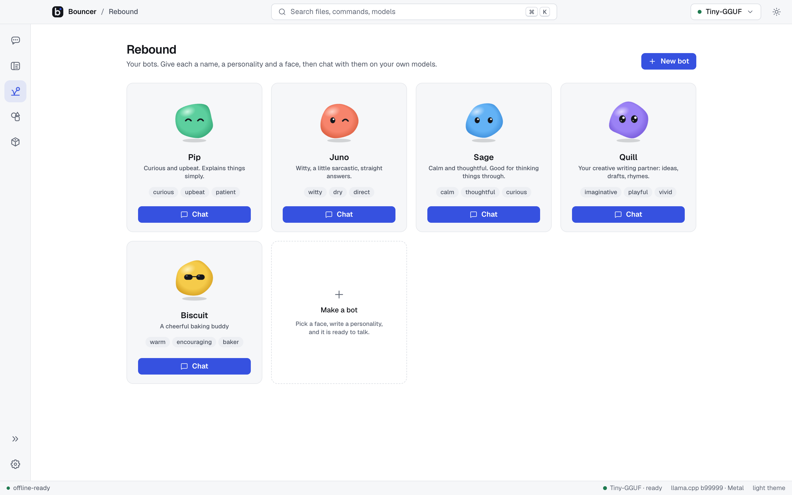
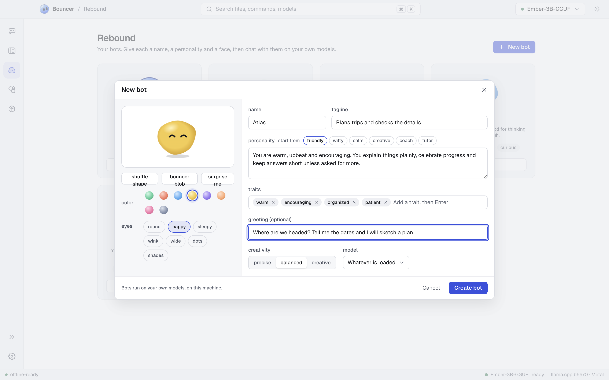
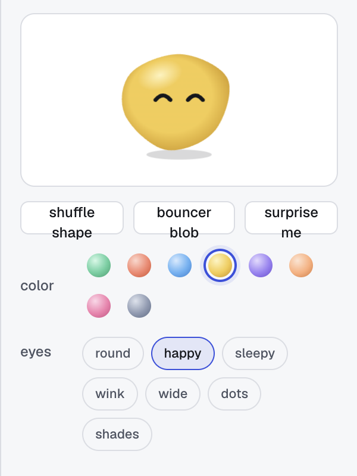

# Rebound

Rebound is where you make and chat with bots. A bot is a named persona with its own face, personality, greeting, and preferred model, and it runs on the models you have on your computer.

<picture><source media="(prefers-color-scheme: dark)" srcset="images/rebound-obsidian.png"><source media="(prefers-color-scheme: light)" srcset="images/rebound-light.png"></picture>

## The starter bots

Bouncer comes with five bots:

| Bot | Tagline |
| --- | --- |
| Rebound | A plain, helpful assistant. Clear answers, no persona. |
| Pip | Curious and upbeat. Explains things simply. |
| Juno | Witty, a little sarcastic, straight answers. |
| Sage | Calm and thoughtful. Good for thinking things through. |
| Quill | Your creative writing partner: ideas, drafts, rhymes. |

## Make a bot

Click **New bot** at the top of Rebound, or **Make a bot** in the last tile. The dialog has a face on the left and the personality on the right.

<picture><source media="(prefers-color-scheme: dark)" srcset="images/rebound-builder-obsidian.png"><source media="(prefers-color-scheme: light)" srcset="images/rebound-builder-light.png"></picture>

### Face

Pick a face from the controls under the preview:

- **color**: eight colors.
- **eyes**: seven eye styles.
- **shuffle shape**: keeps the color and eyes and changes the shape.
- **surprise me**: picks a new random face.

<picture><source media="(prefers-color-scheme: dark)" srcset="images/bot-avatars-obsidian.png"><source media="(prefers-color-scheme: light)" srcset="images/bot-avatars-light.png"></picture>

### Name, tagline, and personality

- **name** is required. Give it a short name, such as Pip.
- **tagline** is a few words about what the bot is like. It shows on the bot's card.
- **personality** is required. Describe who the bot is, how it talks, and what it cares about. To start, pick one of the **start from** options: **friendly**, **witty**, **calm**, **creative**, **coach**, or **tutor**. The option fills in a starting personality you can edit.

### Traits

Add up to eight short traits, such as `curious` or `patient`. Type a trait and press <kbd>Enter</kbd> or <kbd>,</kbd>. Press <kbd>Backspace</kbd> in an empty field to remove the last one, or click the x on a trait.

### Greeting

The greeting is the first message the bot says in a new chat. Leave it empty if you do not want one.

### Creativity

**Creativity** sets how varied the bot's replies are:

- **precise** gives steady, predictable answers.
- **balanced** is the default middle ground.
- **creative** gives more varied and surprising answers.

### Model

**Model** chooses the model the bot prefers. **Whatever is loaded** uses the model you have loaded.

Click **Create bot** to save a new bot, or **Save** when you edit one. **Cancel** closes the builder without saving.

## Chat with a bot

Each bot has a room in Rebound. The room holds the bot and its chats, and you chat with the bot there. Bots and their chats never appear in [Chat](chat.md), which is for plain conversations with a model.

1. Open Rebound and click the bot's card to open its room.
2. Start a new chat, or continue one of the chats already listed with the bot.
3. Type a message and send it. The bot replies in character. To delete a chat, use its trash icon in the room.

The bot's personality replaces the presets in its chats. A bot uses its own system prompt and sampling, so the preset does not apply.

## Edit, duplicate, reset, and delete

Hover a bot's card and open its menu (the three dots):

- **Edit** opens the builder with the bot's current settings.
- **Duplicate** makes a copy you can change.
- **Reset to original** restores a starter bot to how it shipped. It appears only on starter bots.
- **Delete** removes the bot and all of its chats.

## Bring up Rebound from anywhere

Turn these on in **Settings › Rebound**. Both are off until you do, and they belong to this computer only.

- **Hotkey**: a global shortcut that opens Rebound with your last bot, from any app. Click **change** and press the keys you want. While it is on, other apps can't use that shortcut; if one already does, Bouncer says so.
- **Menu bar icon** (macOS) or **Tray icon** (Windows and Linux): your bots, one click away. While it shows, closing the window keeps Bouncer running in the background.

## Memory

A bot can remember short facts about you across its chats, such as your name or a project you're on. Click **memory** in the bot's room to read, edit, add, delete or wipe them. Memories stay on this computer.

- The bot reads its memories in every chat, and saves new facts itself when your model can call tools.
- Turn the **Memory** switch off to stop using them; the list is kept until you wipe it.

## Routines

A routine sends a bot a prompt on a schedule and posts the reply in its own chat, named after the routine, with a notification. Click **routines** in the bot's room.

- **daily**: at a time, on the days you pick.
- **repeat**: every so many minutes or hours.
- **on demand**: only when you click **run now**.

Routines run while Bouncer is open. Turn one off with its switch, or delete it.

## Voice

Click **voice** in the bot's room.

- **Read replies aloud** speaks each reply when it finishes, using your computer's own voices. Pick a **voice** and a **speed**, and click **try it**. Every bot reply also has a read aloud button.
- **Talk to the bot**: the mic button next to send turns what you say into text in the message box. Click it to start, click again to stop. <kbd>Esc</kbd> throws the recording away.

Speech input runs [whisper.cpp](https://github.com/ggml-org/whisper.cpp) on your computer; nothing is sent anywhere. The first time, pick a speech model and click **download**:

| Model | Size | |
| --- | --- | --- |
| tiny | 78 MB | fastest, rougher |
| base | 148 MB | quick and good for chat (default) |
| small | 488 MB | more accurate, slower |

Bouncer also downloads whisper.cpp itself once (about 9 to 66 MB, depending on your system). Every download is checked against a known checksum. macOS asks for microphone access the first time you record.

## Connectors

Connectors let a bot read things on your computer. They are off until you pick something, the bot can only read, and it needs a model that can call tools. Click **connectors** in the bot's room.

- **Files**: one folder the bot can list and read. It can't see anything outside that folder, and it never changes a file. Text files up to 200 KB.
- **Calendar**: an `.ics` file exported from your calendar app. The bot reads your events to answer questions like "what's on Thursday?". Export a fresh file to update it.

Click **change** to pick another folder or file, or the x to turn a connector off. Mail is coming later.

## Related

- [Chat](chat.md) for plain chats with a model
- [Models](models.md) for installing the models bots can use
- [Slash commands](slash-commands.md)
- [Keyboard shortcuts](keyboard-shortcuts.md)
