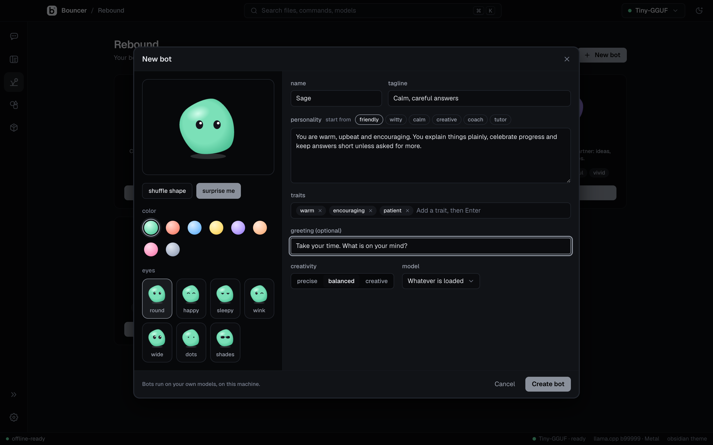

# Rebound

Rebound is where you make and chat with bots. A bot is a named persona with its own face, personality, greeting, and preferred model, and it runs on the models you have on your computer.

## The starter bots

Bouncer comes with four bots:

| Bot | Tagline |
| --- | --- |
| Pip | Curious and upbeat. Explains things simply. |
| Juno | Witty, a little sarcastic, straight answers. |
| Sage | Calm and thoughtful. Good for thinking things through. |
| Quill | Your creative writing partner: ideas, drafts, rhymes. |

## Make a bot

Click **New bot** at the top of Rebound, or **Make a bot** in the last tile. The dialog has a face on the left and the personality on the right.

### Face

Pick a face from the controls under the preview:

- **color**: eight colors.
- **eyes**: seven eye styles.
- **shuffle shape**: keeps the color and eyes and changes the shape.
- **surprise me**: picks a new random face.

### Name, tagline, and personality

- **name** is required. Give it a short name, such as Pip.
- **tagline** is a few words about what the bot is like. It shows on the bot's card.
- **personality** is required. Describe who the bot is, how it talks, and what it cares about. To start, pick one of the **start from** options: **friendly**, **witty**, **calm**, **creative**, **coach**, or **tutor**. The option fills in a starting personality you can edit.

### Traits

Add up to eight short traits, such as `curious` or `patient`. Type a trait and press <kbd>Enter</kbd> or <kbd>,</kbd>. Press <kbd>Backspace</kbd> in an empty field to remove the last one, or click the x on a trait.

### Greeting

The greeting is the first message the bot says in a new chat. Leave it empty if you do not want one.

### Creativity

**Creativity** sets how varied the bot's replies are:

- **precise** gives steady, predictable answers.
- **balanced** is the default middle ground.
- **creative** gives more varied and surprising answers.

### Model

**Model** chooses the model the bot prefers. **Whatever is loaded** uses the model you have loaded.

Click **Create bot** to save a new bot, or **Save** when you edit one. **Cancel** closes the builder without saving.

## Chat with a bot

Each bot has a room in Rebound. The room holds the bot and its chats, and you chat with the bot there. Bots and their chats never appear in [Chat](chat.md), which is for plain conversations with a model.

1. Open Rebound and click the bot's card to open its room.
2. Start a new chat, or continue one of the chats already listed with the bot.
3. Type a message and send it. The bot replies in character. To delete a chat, use its trash icon in the room.

The bot's personality replaces the presets in its chats. A bot uses its own system prompt and sampling, so the preset does not apply.

## Edit, duplicate, reset, and delete

Hover a bot's card and open its menu (the three dots):

- **Edit** opens the builder with the bot's current settings.
- **Duplicate** makes a copy you can change.
- **Reset to original** restores a starter bot to how it shipped. It appears only on starter bots.
- **Delete** removes the bot and all of its chats.

## Related

- [Chat](chat.md) for plain chats with a model
- [Models](models.md) for installing the models bots can use
- [Slash commands](slash-commands.md)
- [Keyboard shortcuts](keyboard-shortcuts.md)
