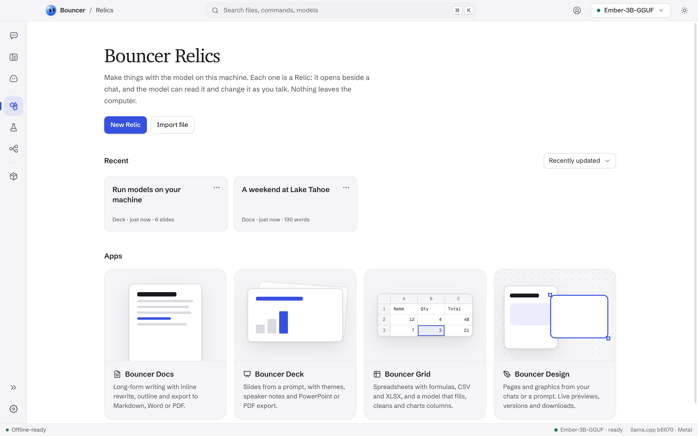
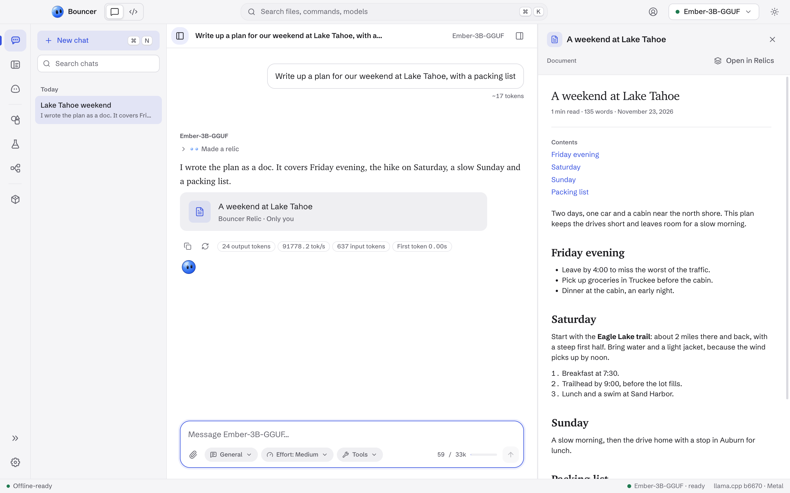
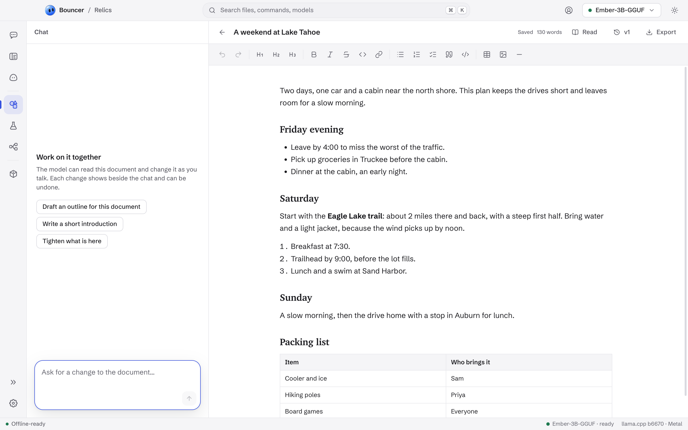
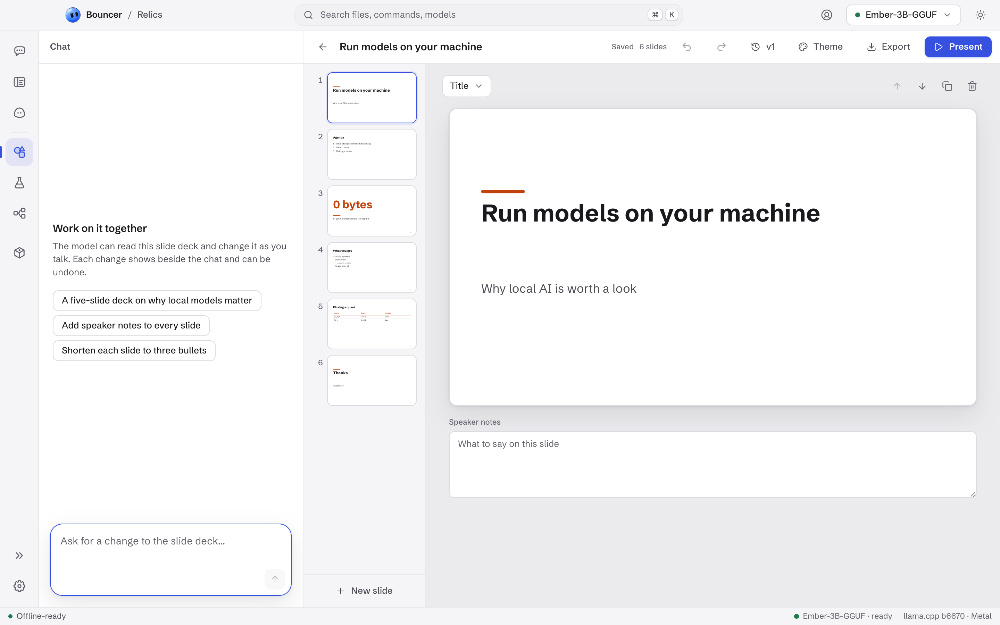
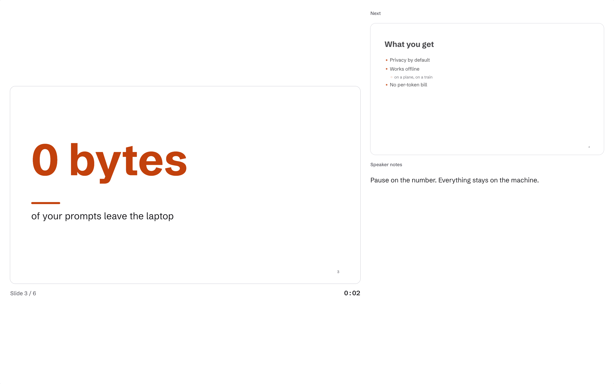

# Bouncer Relics

A **Relic** is something the model makes for you on your computer: a document, a slideshow, a spreadsheet or a web page. Ask for one in a chat and it opens beside the chat, where the model can read it and change it as you talk. Nothing leaves the computer.

<picture><source media="(prefers-color-scheme: dark)" srcset="images/relics-obsidian.png"><source media="(prefers-color-scheme: light)" srcset="images/relics-light.png"></picture>

Bouncer Relics was called Bouncer Studio before v0.21.

Open Relics from the activity bar: **Relics** (<kbd>⌘</kbd> <kbd>5</kbd>, <kbd>Ctrl</kbd> <kbd>5</kbd> on Windows and Linux). The home page has **New Relic**, **Import file** (a `.md` or `.txt` document, or a `.csv` or `.xlsx` spreadsheet), your recent Relics and the four apps: Docs, Deck, Grid and Design.

Each card in **Recent** has a menu with **Rename**, **Duplicate** and **Delete**. A document's card also has **Make a deck**.

## Relics beside the chat

When a reply makes a Relic, it opens in a panel beside the chat:

- a document to read,
- a slideshow to flip through and present,
- a spreadsheet with its formulas worked out,
- a page, with each of its versions.

Click the Relic's card in the reply to open it in the panel again. The panel keeps up as the model changes the Relic. **Open in Relics** opens the Relic in its app to edit, with the chat beside it. See [Chat](chat.md#relics) for how to ask for one.

<picture><source media="(prefers-color-scheme: dark)" srcset="images/relics-panel-obsidian.png"><source media="(prefers-color-scheme: light)" srcset="images/relics-panel-light.png"></picture>

## Versions

Every Relic keeps its versions: a doc, a deck, a spreadsheet or a page. The model's first draft is version 1, and each change the model makes is a new version. Your own edits are saved as a version too, folded into one while you keep typing.

- **In the panel beside the chat**, step through the versions with the arrows. An older version is shown read-only.
- **In Docs, Deck and Grid**, the **Versions** menu in the header (it shows the version number, such as **v3**) lists each version with who made it and when. Pick an older one to bring it back. It comes back as a new version, so nothing newer is lost.
- Each Relic keeps its last 50 versions.

## Docs

Long-form writing. Select text to rewrite, shorten, expand, fix the grammar or change its tone, or ask the model to continue or draft. Export a document as Markdown, Word or PDF.

<picture><source media="(prefers-color-scheme: dark)" srcset="images/relics-docs-obsidian.png"><source media="(prefers-color-scheme: light)" srcset="images/relics-docs-light.png"></picture>

### Read view

**Read** shows the document as a finished piece: a cover with the title, reading time, word count and date, contents that jump to each heading, and typography set for reading. Links open in your browser. **Edit** goes back to editing.

## Deck

Slideshows with speaker notes and five themes: **Graphite**, **Paper**, **Obsidian**, **Ember** and **Glacier**. Export a deck as PowerPoint, PDF or Markdown.

Slides come in these layouts: title, title and bullets, two columns, quote, section, big number, numbered list and table.

<picture><source media="(prefers-color-scheme: dark)" srcset="images/relics-deck-obsidian.png"><source media="(prefers-color-scheme: light)" srcset="images/relics-deck-light.png"></picture>

- **Layouts from the text**: the model picks a layout from what a slide says, such as a figure as its heading or rows of a table.
- **Rich text**: slide points keep **bold**, *italic* and `code`, and a point can have sub-points (<kbd>Tab</kbd> and <kbd>Shift</kbd> <kbd>Tab</kbd> in the editor). PowerPoint and PDF exports keep them too.

### Present

**Present** shows the deck full screen. Move with the arrow keys and press <kbd>Esc</kbd> to stop. A progress bar runs along the bottom, and these keys help:

| Key | What it does |
| --- | --- |
| <kbd>S</kbd> | Presenter view: the current slide, the next one, your notes and a timer |
| <kbd>G</kbd> | All slides at once; pick one to jump to it |
| <kbd>B</kbd> | Blank the screen |
| <kbd>Esc</kbd> | Close the presenter view, the slide overview or the blank screen, then stop presenting |

<picture><source media="(prefers-color-scheme: dark)" srcset="images/relics-present-obsidian.png"><source media="(prefers-color-scheme: light)" srcset="images/relics-present-light.png"></picture>

### A deck from a document

Turn a Docs document into a deck: choose **New Relic** › **Deck from a document**, or **Make a deck** in a document's card menu.

1. Pick the document and a theme.
2. Click **Make slides**.

With a model loaded, the model writes the slides: a title slide, then short points that follow the document's headings, with speaker notes. The dialog counts the slides as they arrive. **Stop** keeps the slides written so far.

With no model loaded, the slides follow the document's headings: the title and first sentence make the title slide, each top-level heading makes a slide, and its list items and first sentences become the points.

The new deck opens when it's ready. The document isn't changed.

## Grid

Spreadsheets with formulas, CSV and XLSX files, and a model that fills, cleans and charts columns.

## Design

Pages and graphics made from a prompt, or from a chat's Relic. Each change is a new version; step through them with the arrows. **Preview** shows the page live and **Code** shows its source. **Copy** and **Download** work on the version shown.

### Export to code

**Export to code** turns the version shown into source files in the folder open in the [IDE](ide.md).

- **React component**: a `.jsx` component and its `.css` file. The page's script runs in an effect after the component mounts. The default folder is `src/components/<Name>`.
- **HTML and CSS**: `index.html` with `styles.css` and `script.js` beside it.

Images embedded in the page become files in an `assets` folder next to the code. Fonts or scripts the page loads from the web, such as Google Fonts, are listed when the export finishes; add them to your project yourself.

If no folder is open in the IDE, the dialog offers to open one. Bouncer writes only inside that folder. If a file it would write already exists, it lists the file and asks before replacing it. **Open in the IDE** opens the component, or `index.html`, in a tab.

## Related

- [Chat](chat.md#relics): asking for a Relic in a chat
- [IDE](ide.md): where exported code goes
- [Models](models.md): load a model for the writing actions in Relics
