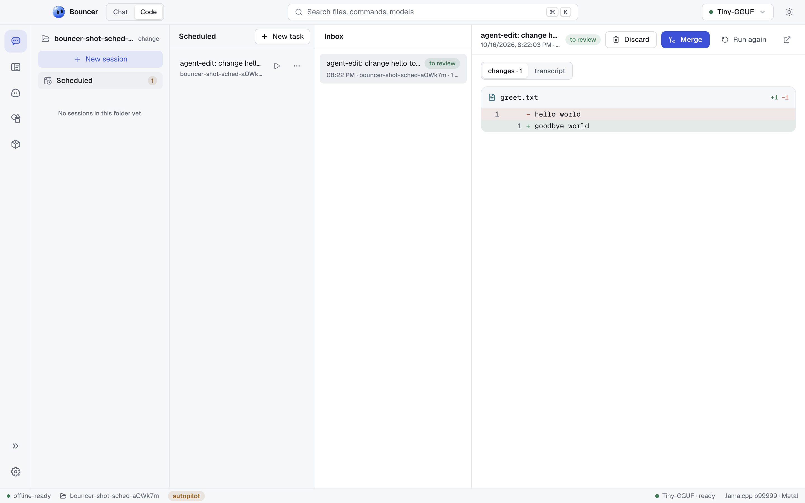

# Scheduled tasks

A scheduled task is a prompt that Bouncer Code runs in a folder, either when you ask or on a timetable. Each run lands in an inbox, where you review its changes and then merge or discard them. Nothing a scheduled run does reaches your folder until you merge it.

<picture><source media="(prefers-color-scheme: dark)" srcset="images/code-scheduled-obsidian.png"><source media="(prefers-color-scheme: light)" srcset="images/code-scheduled-light.png"></picture>

## Open the Scheduled view

Open Bouncer Code and click **Scheduled** in the sessions list. The view has three columns:

- **Scheduled**: your tasks, with their folder and schedule.
- **Inbox**: the runs of all tasks, newest first. A badge on **Scheduled** in the sessions list counts the runs that need you.
- **Run**: the run you picked, with its changes or transcript.

Scheduled tasks run while Bouncer is open. If you quit during a run, that run is marked **stopped**.

## Create a task

Click **New task** and fill in the dialog:

| Field | What to enter |
| --- | --- |
| **folder** | The folder the task works in. Click it to choose a folder. It can't be changed after the task is created. |
| **what to do** | The prompt, for example "Fix the failing tests and explain what was wrong." Required. |
| **name (optional)** | A title for the task. If you leave it empty, the title comes from the prompt. |
| **mode** | The mode the run uses. The default is **accept edits**. See [modes](code.md#modes). |
| **when** | When the task runs. See the table below. |
| **Work in a separate git worktree** | On by default. See [how runs work](#how-runs-work). |

Choose **when** from these options:

| Option | Runs | Extra fields |
| --- | --- | --- |
| **on demand** | Only when you click **Run now** or **Create and run** | None |
| **once** | One time, at the date and time you set | A date and time picker. It starts one hour from now. |
| **daily** | Every day at a time you set, or on the weekdays you pick | A time in 24-hour format (HH:MM). Pick days with the day buttons. If you pick none, it runs every day. |
| **repeat** | Every N minutes | The number of minutes, at least 5. |

The line under the fields says in plain words when the task will run.

Then click:

- **Create** to save the task and run it on its schedule.
- **Create and run** to save it and start a run now.

Click the **More** button (three dots) on a task to **Edit**, **Pause** or **Resume** it (not available for on-demand tasks), or **Delete** it. Click the play button on a task to run it now.

## How runs work

Each run is an ordinary Bouncer Code session that runs in the mode you chose.

- **In a git repository with the worktree option on**, a run gets its own git worktree. The worktree starts from the folder's last commit, on a new branch named `rebound/` followed by a short id. Your folder is not touched while the run works.
- **In a folder that is not a git repository**, or with the worktree option off, the run edits the folder directly.
- **Runs never commit.** Their changes stay uncommitted until you merge them, and you review every run.

## Inbox states

Each run shows one of these states:

| State | Meaning |
| --- | --- |
| **working** | The run is going and nothing is waiting for you. |
| **needs you** | The run is waiting for you to approve a step. |
| **to review** | The run finished and changed files. Review them, then merge or discard. |
| **no changes** | The run finished without changing any file. |
| **merged** | You merged the changes into the folder. |
| **discarded** | You threw the changes away. |
| **failed** | The run could not finish. The run's detail says why, for example when no model was loaded. |
| **stopped** | You stopped the run, or Bouncer quit while it was running. |

## Review a run

Click a run in the inbox. The run's header shows its title, when it started, its folder and branch, and its state.

- **changes** lists each changed file with its diff. This is the default tab once a run has changes.
- **transcript** shows the whole session, including any step that is waiting for you.

If a run **needs you**, its transcript shows the approval card. Approve or deny the step the same way as in Bouncer Code: <kbd>⌘</kbd> <kbd>↵</kbd> approves and <kbd>Esc</kbd> denies (<kbd>Ctrl</kbd> <kbd>Enter</kbd> and <kbd>Esc</kbd> on Windows and Linux). To stop a running run, click **Stop**.

To open the run's session in Bouncer Code, click the open icon in the header.

## Merge

Click **Merge** to apply a finished run's changes to the folder. Merge is enabled when the run has changed files.

- The changes land in the folder as **staged, uncommitted changes**. Review them with source control, then commit them yourself.
- If you edited the same lines by hand since the run started, Bouncer merges around your edits.
- If a file conflicts, Bouncer writes conflict markers into it and tells you which files. Resolve them in the folder.
- If a file has **unstaged edits** in your folder, Bouncer stops and names the file. Stage, commit or stash those edits, then click **Merge** again.
- After a successful merge, the run's worktree and branch are removed, and the run is marked **merged**.

In a folder that is not a git repository, or for a run that edited the folder directly, Merge only keeps the run and marks it merged. Its changes are already in the folder.

## Discard

Click **Discard** to throw a run's changes away. In a worktree, the worktree and its branch are removed. In a folder the run edited directly, the folder is rewound to where the run started. The run is marked **discarded**.

## Run again

Click **Run again** on a finished run to start a new run of the same task. The original run stays in the inbox.

## Notifications

Bouncer sends a desktop notification when:

- a run is waiting for an approval: "A scheduled task needs you"
- a run finishes: "Finished. Review the changes in Bouncer Code."
- a run fails, with the reason
- a run is stopped

## Related

- [Bouncer Code](code.md): sessions, modes, approvals and rewind, which runs use too
- [Bouncer IDE](ide.md): review and edit the folder in the editor
- [Models](models.md): load a model before a task runs
- [Troubleshooting](troubleshooting.md): when a run fails or a merge will not apply
