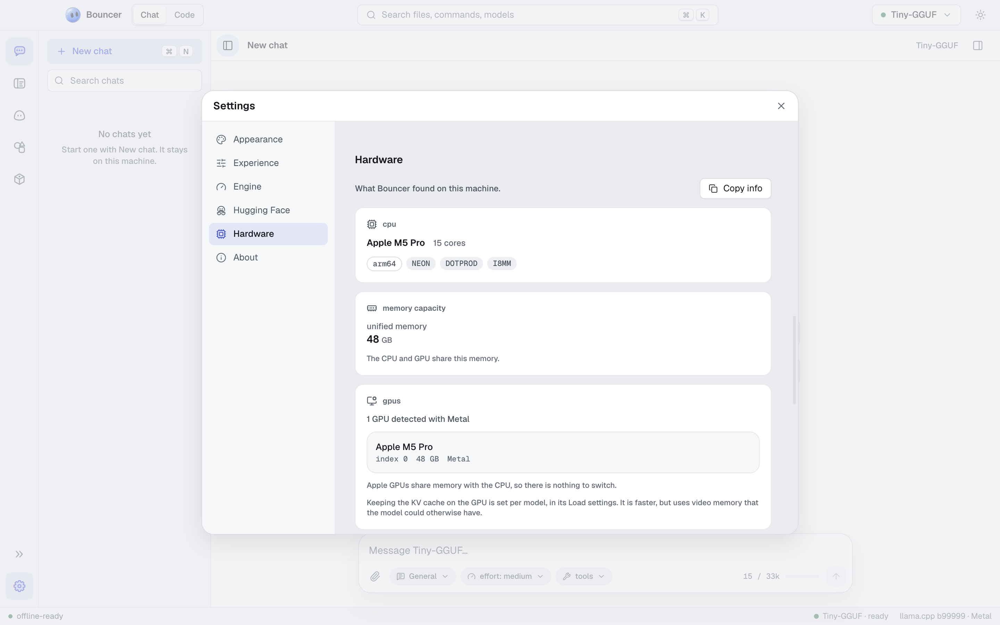

# Settings

Settings control how Bouncer looks and behaves, which engine it uses, how it connects to Hugging Face, and how it treats your hardware. Open it from the app, and pick a section from the list on the left.

The sections are **Appearance**, **Experience**, **Engine**, **Hugging Face**, **Hardware**, and **About**.

## Appearance

Choose how Bouncer looks.

**Theme** has four options:

| Option | Look |
| --- | --- |
| System | Follows your operating system's light or dark setting. |
| Graphite | Soft dark gray, easy on the eyes. This is the dark theme. |
| Obsidian | Pitch black, for OLED screens. |
| Light | Bright surfaces for daytime use. |

**Accent** sets the highlight color used for buttons, focus, and selected items. `auto` uses Signal, or Slate when the Obsidian theme is on. You can also choose Signal, Slate, Mono, Ember, Glacier, Ultraviolet, or Lime.

Turn on **High contrast** for brighter secondary text, firmer borders, and a thicker focus ring. It helps when text is hard to read.

## Experience

**Experience** sets how much Bouncer shows you.

- **Standard** shows simple controls with smart defaults. This is the right choice for most people.
- **Developer** shows every load and inference setting, the raw details of models and engines, and tool traces from Bouncer Code.

Under the mode choice, use **Export settings…** to save your settings as a `.bcn` file, and **Import…** to open one. Import asks which parts to take: settings, presets, or mode. See [file formats](file-formats.md) for what a configuration file holds.

Click **Replay onboarding** to see the first-run tour again.

## Engine

The **Engine** section manages llama.cpp, the program that runs your models. It lists installed builds, sets the active one, checks for updates, and shows logs. It also sets the backend that matches your hardware. See [models](models.md#engine) for the full list of controls.

## Hugging Face

The **Hugging Face** section shows whether you are signed in. Sign in with an access token if you want to download gated models. The token is stored encrypted in your operating system's keychain, and Bouncer sends it only to Hugging Face. Public models never need it. See [models](models.md#gated-models-and-hugging-face-sign-in) for the steps.

## Hardware

The **Hardware** section shows what Bouncer found on your machine, and how the models use it.

<picture><source media="(prefers-color-scheme: dark)" srcset="images/settings-hardware-obsidian.png"><source media="(prefers-color-scheme: light)" srcset="images/settings-hardware-light.png"></picture>

- **CPU** shows the processor type and its features. **Recommended backend** shows which engine backend suits this machine.
- **Memory capacity** shows your total RAM, or unified memory on Apple silicon.
- **GPUs** lists each GPU with its video memory, and the backend it uses. Click **Copy info** to copy a summary of this section, which is useful when you report a problem.
- **Use** switches turn each GPU on or off for the engine. At least one GPU has to stay on. Apple GPUs share memory with the CPU, so there is nothing to switch.
- **Resource monitor** shows live use of RAM, CPU, the Bouncer model process, and video memory for each GPU while a model runs. It reads "no model loaded" when nothing is running.

The resource monitor updates live, so you can watch a model's memory use while you chat.

### Guardrails

Guardrails decide what Bouncer does when you try to load a model that will not fit your machine. The fit estimate is explained in [models](models.md#check-the-fit).

| Option | Behavior |
| --- | --- |
| Off | Never stops you. A model that doesn't fit may crash or swap heavily. |
| Relaxed | Warns before loading a model that won't fit, but lets you continue. This is the default. |
| Strict | Blocks loading a model that won't fit this machine. |

Keeping the KV cache on the GPU is a per-model setting, in the model's **Load** tab. It is faster, but it uses video memory the model could otherwise have.

## About

**About** shows the Bouncer name and version, your platform and architecture, and the versions of Electron, Chrome, and Node that the app runs on. Include these details when you report a problem.

For how Bouncer gets new versions, see [updates](updates.md).

## Related

- [Models](models.md): the library, load options, and the engine.
- [File formats](file-formats.md): sharing settings as `.bcn` files.
- [Privacy](privacy.md): what Bouncer sends over the internet, and when.
- [Troubleshooting](troubleshooting.md): what to check when a model is slow or won't load.
