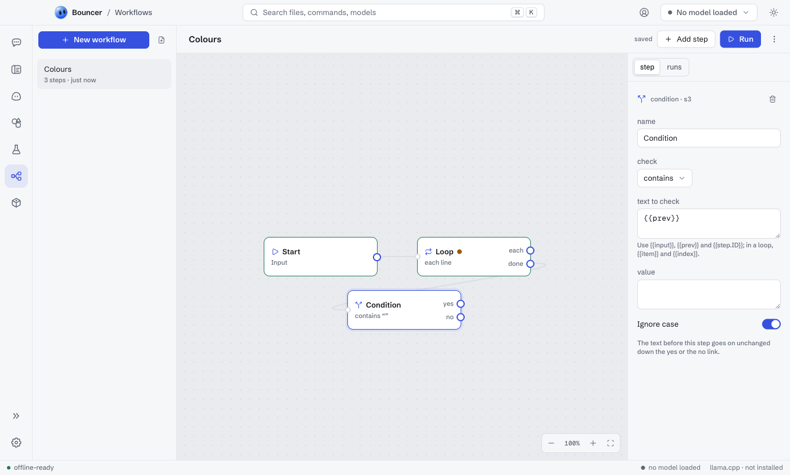
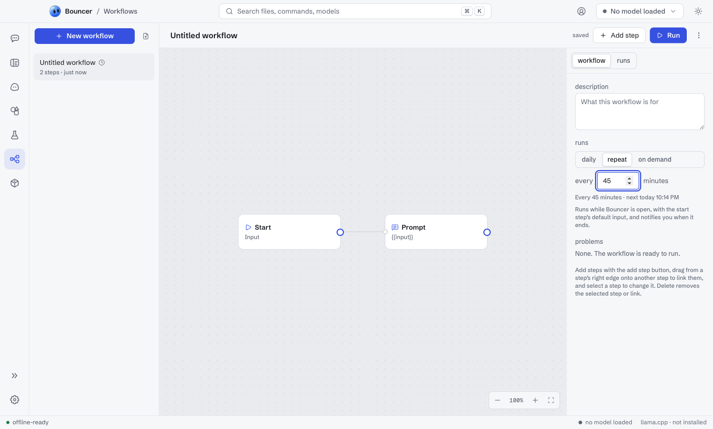

# Workflows

A workflow chains models, tools and agents into steps that run one after another, each step working on the one before it. Build one on a canvas, run it whenever you like, on a schedule, from a Rebound bot or from the terminal, and share it as a `.bflow` file. Open Workflows from the rail, or with <kbd>⌘</kbd> <kbd>7</kbd> (<kbd>Ctrl</kbd> <kbd>7</kbd> on Windows and Linux).

<picture><source media="(prefers-color-scheme: dark)" srcset="images/workflows-obsidian.png"><source media="(prefers-color-scheme: light)" srcset="images/workflows-light.png"></picture>

## Make a workflow

1. Click **New workflow**. It starts with a **start** step linked to a **prompt** step.
2. Name it in the header.
3. Click **Add step** and pick a kind. A step added while another is selected is linked after it.
4. To link two steps, drag from the round port on a step's right edge onto the other step. Select a link or a step and press <kbd>Delete</kbd> to remove it.
5. Select a step to change it in the panel on the right.

Drag the empty canvas to move around. Scroll to pan, and hold <kbd>⌘</kbd> (<kbd>Ctrl</kbd>) while scrolling to zoom; the buttons in the corner zoom and fit the whole workflow. Arrow keys move the selected step. Changes save by themselves.

## Steps

| Step | What it does |
| --- | --- |
| **start** | Where a run begins. It names the input (such as "Topic") and can hold a default input for schedules. |
| **prompt** | Asks a model once. Pick the model, or leave it on the one you have loaded. |
| **tool** | Calls a tool with set arguments: web search, open a web page, or a desktop notification. |
| **agent** | A model that may call the tools you allow, round after round, until it answers. |
| **condition** | Takes the **yes** or **no** link: the text contains, equals or matches a pattern, is empty, or a model answers a yes-or-no question about it. The text goes on unchanged. |
| **loop** | Runs the steps on its **each** link once per line, list item or count, then follows **done** with the results joined. |

Text fields can use what came before:

- `{{input}}`: the run's input.
- `{{prev}}`: the output of the step before.
- `{{step.ID}}`: the output of a step by its id (shown at the top of its panel).
- `{{item}}` and `{{index}}`: the current item and its number, inside a loop.

With nothing selected, the panel shows the workflow's description, when it runs, and any problems. A step with a problem has a dot on the canvas; **Run** waits until the errors are fixed.

## Run a workflow

Click **Run**, type the input and click **Run** again. The **runs** tab follows the run step by step, and the canvas rings each step as it finishes. Open a step in the log to see its input, output, model, tool calls, tokens and time. **Stop** ends a run. Every run is kept in the history, newest first; hover a row to delete it.

Up to four workflows run at once.

## Run on a schedule

<picture><source media="(prefers-color-scheme: dark)" srcset="images/workflows-schedule-obsidian.png"><source media="(prefers-color-scheme: light)" srcset="images/workflows-schedule-light.png"></picture>

Select nothing, then under **schedule** pick **daily** (a time, and days if you want) or **repeat** (every so many minutes, at least five). The workflow runs with its start step's default input and notifies you when it ends. A clock in the list marks scheduled workflows. Schedules run while Bouncer is open, and they stay on this computer: they are not saved in the `.bflow` file, so a workflow someone shares never starts on a timer by itself.

## From a Rebound bot

A [Rebound](rebound.md) bot whose model can use tools sees your workflows and can run one with its input, then answer from the output. Ask it, for example, "run Digest on today's space news".

## From the terminal

```sh
bouncer workflow list
bouncer workflow run Digest "space news"
echo "space news" | bouncer workflow run Digest
```

The output is printed, and each step is reported as it ends. See [Terminal](cli.md#workflows).

## Share a workflow

**Export as .bflow** in the header's menu saves the workflow as a file. Open a `.bflow` file, or click the import button beside **New workflow**, to add one to your library. See [File formats](file-formats.md#bouncer-workflow-bflow).

## Related

- [Rebound](rebound.md)
- [Terminal](cli.md)
- [File formats](file-formats.md)
